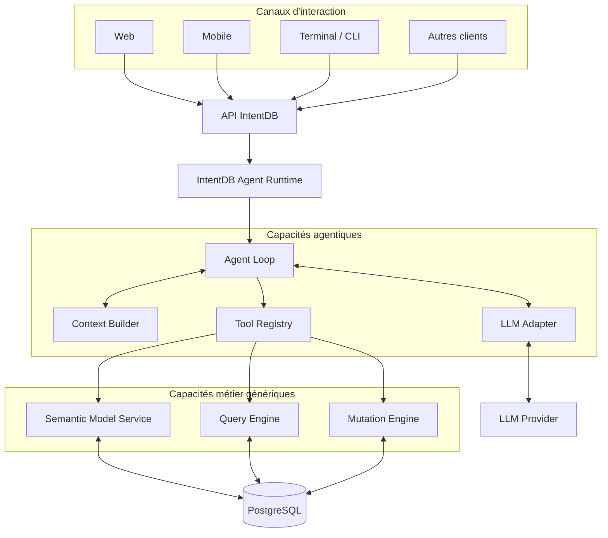
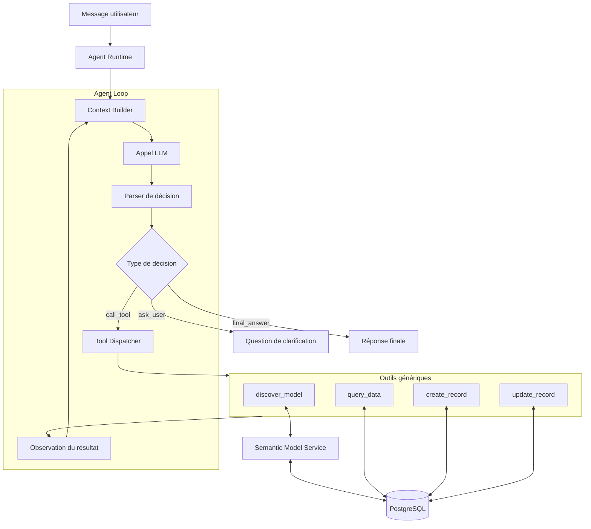

# IntentDB Agent — Architecture technique du MVP

**Version :** 0.1  
**Statut :** Proposition d'architecture initiale  
**Périmètre :** Conception et implémentation du cœur agentique d'IntentDB  
**Langage :** Python  
**Base de données :** PostgreSQL

---

## 1. Contexte et vision

IntentDB est un concept d'application pilotée par l'intention métier.

L'utilisateur interagit avec le système en langage naturel, à travers une interface conversationnelle similaire à ChatGPT, Gemini ou DeepSeek.

Le canal d'interaction n'est pas une composante fondamentale du produit. Il peut s'agir d'une interface Web, d'une application mobile, d'un terminal ou de tout autre client capable d'échanger avec IntentDB.

Le cœur du système est **IntentDB Agent**, qui interprète les intentions de l'utilisateur, exploite le modèle de données et le modèle sémantique, choisit les opérations nécessaires et produit une réponse adaptée.

L'objectif du MVP est de vérifier si cette approche permet de répondre à des besoins métier sans développer une fonctionnalité spécifique pour chaque intention possible.

### 1.1 Hypothèse fondamentale

Un utilisateur devrait pouvoir interagir avec ses données métier en exprimant directement son besoin, sans connaître :

- Le schéma physique de la base de données.
    
- Les tables et les colonnes.
    
- Les relations techniques entre les entités.
    
- Les API métier disponibles.
    
- Les fonctionnalités qui ont été préprogrammées.
    

Le système doit s'appuyer sur un modèle métier explicite et un agent capable de découvrir et d'exploiter ce modèle.

### 1.2 Objectifs du MVP

Le MVP doit permettre de démontrer que l'agent peut :

1. Comprendre une intention exprimée en langage naturel.
    
2. Découvrir les concepts, attributs et relations du modèle sémantique.
    
3. Déterminer les opérations nécessaires pour satisfaire la demande.
    
4. Utiliser des outils génériques pour interagir avec les données.
    
5. Examiner les résultats obtenus et adapter son plan si nécessaire.
    
6. Maintenir le contexte d'une conversation.
    
7. Répondre à des demandes variées sans développement spécifique par scénario.
    

L'expérimentation commencera avec le domaine des paroisses, dont le modèle de données et le modèle sémantique ont déjà été définis.

### 1.3 Principes de conception

- **Agent-centric :** l'agent constitue le cœur fonctionnel du système.
    
- **Interface agnostique :** les clients Web, mobile et CLI sont interchangeables.
    
- **LLM agnostique :** l'architecture ne doit pas dépendre d'un fournisseur unique.
    
- **Modèle métier explicite :** les concepts et leurs relations sont décrits par le modèle sémantique.
    
- **Opérations génériques :** les outils doivent fonctionner sur différents concepts métier.
    
- **Exécution itérative :** l'agent peut enchaîner plusieurs opérations avant de répondre.
    
- **Séparation des responsabilités :** le LLM raisonne et propose ; le runtime orchestre ; les outils exécutent.
    
- **Évolution progressive :** les capacités sont ajoutées en fonction des résultats expérimentaux.
    

Le MVP est une expérimentation fonctionnelle. La gouvernance complète, le contrôle avancé des accès et les mécanismes de sécurité industrialisés feront l'objet d'une phase ultérieure. Cela ne dispense pas de mettre en place des précautions minimales pendant les tests.

---

## 2. Architecture générale

### 2.1 Vue conceptuelle



### 2.2 Responsabilités des composants

|Composant|Responsabilité|
|---|---|
|API IntentDB|Recevoir les messages et retourner les réponses de l'agent.|
|Agent Runtime|Gérer l'exécution d'une demande et coordonner ses composants.|
|Agent Loop|Enchaîner les décisions du LLM, les appels d'outils et les observations.|
|Context Builder|Préparer le contexte utile à partir de l'historique et de l'état courant.|
|LLM Adapter|Isoler l'intégration avec le fournisseur de modèle de langage.|
|Tool Registry|Déclarer et retrouver les outils utilisables par l'agent.|
|Semantic Model Service|Exposer les concepts, attributs, relations et règles métier.|
|Query Engine|Traduire une opération de lecture structurée en accès aux données.|
|Mutation Engine|Réaliser les opérations de création et de modification supportées.|
|PostgreSQL|Persister les données métier, les métadonnées et les conversations.|

L'architecture peut être implémentée dans une seule application Python modulaire. Il n'est pas nécessaire de commencer par une architecture microservices.

---

## 3. Stack technique proposée

|Élément|Choix initial|Justification|
|---|---|---|
|Langage|Python|Expérimentation rapide autour des LLM et des agents.|
|API|FastAPI|Exposition d'une API HTTP pour les clients.|
|Modèles de données|Pydantic|Validation des structures échangées entre composants.|
|Accès SQL|SQLAlchemy|Interaction avec PostgreSQL.|
|Base de données|PostgreSQL|Persistance métier et métadonnées sémantiques.|
|Intégration LLM|Adaptateur interne|Remplacer le fournisseur sans réécrire l'agent.|
|Tests|pytest|Tests unitaires et scénarios d'intégration.|
|Interface initiale|Web conversationnel minimal ou CLI|Valider rapidement la chaîne fonctionnelle.|

Cette stack est une proposition de départ. Le choix définitif du fournisseur LLM et des bibliothèques associées reste ouvert.

Pour la première version, privilégier une boucle d'agent développée dans le projet plutôt qu'une dépendance immédiate à un framework agentique complet.

---

## 4. Architecture interne d'IntentDB Agent

### 4.1 Vue détaillée



### 4.2 Responsabilités du runtime

Le runtime est responsable du cycle d'exécution :

- Recevoir l'intention et le contexte de conversation.
    
- Construire les messages destinés au LLM.
    
- Récupérer et valider sa décision.
    
- Exécuter l'outil demandé lorsque la décision est `call_tool`.
    
- Réinjecter le résultat de l'outil dans le contexte.
    
- Continuer jusqu'à une réponse finale ou une demande de clarification.
    
- Arrêter l'exécution en cas de limite atteinte ou d'erreur non récupérable.
    

Le runtime ne doit pas contenir de logique spécifique au domaine des paroisses.

### 4.3 Responsabilités du LLM

Le LLM doit :

- Comprendre l'intention exprimée.
    
- Exploiter le contexte et les informations sémantiques disponibles.
    
- Identifier les informations manquantes.
    
- Proposer une opération ou un outil adapté.
    
- Interpréter les résultats retournés par les outils.
    
- Déterminer si la demande est satisfaite.
    
- Formuler une réponse compréhensible.
    

Le LLM ne doit pas être responsable de l'exécution directe de requêtes SQL arbitraires.

---

## 5. Contrat de décision entre le LLM et le runtime

Le runtime doit recevoir une décision structurée plutôt qu'un texte libre difficile à interpréter de manière fiable.

### 5.1 Types de décisions

Trois types sont nécessaires pour la première version.

#### `call_tool`

L'agent demande l'exécution d'un outil.

#### `ask_user`

L'agent demande une précision à l'utilisateur.

#### `final_answer`

L'agent considère qu'il dispose de suffisamment d'informations pour répondre.

### 5.2 Modèles Pydantic

Exemple de première implémentation :

```python
from typing import Any, Literal

from pydantic import BaseModel, Field


class ToolCall(BaseModel):
    name: str
    arguments: dict[str, Any] = Field(default_factory=dict)


class AgentDecision(BaseModel):
    type: Literal["call_tool", "ask_user", "final_answer"]
    tool_call: ToolCall | None = None
    content: str | None = None
```

Cette structure est volontairement minimale.

Le runtime devra vérifier la cohérence entre `type` et les champs associés :

- `call_tool` exige un `tool_call`.
    
- `ask_user` exige une question dans `content`.
    
- `final_answer` exige une réponse dans `content`.
    

Ces contraintes pourront être renforcées dans le modèle Pydantic lui-même.

### 5.3 Exemple d'appel d'outil

```json
{
  "type": "call_tool",
  "tool_call": {
    "name": "discover_model",
    "arguments": {
      "concept": "Member",
      "include": [
        "attributes",
        "relationships"
      ]
    }
  }
}
```

Les noms de concepts sont illustratifs. Les identifiants réels doivent correspondre au modèle sémantique existant.

### 5.4 Exemple de clarification

```json
{
  "type": "ask_user",
  "content": "De quelle paroisse parlez-vous ?"
}
```

### 5.5 Exemple de réponse finale

```json
{
  "type": "final_answer",
  "content": "J'ai trouvé 12 membres correspondant aux critères."
}
```

Les données structurées de résultat seront ajoutées au contrat de réponse si l'interface doit présenter des tableaux ou des listes de manière native.

---

## 6. Contrat des outils génériques

### 6.1 Interface commune

Tous les outils doivent respecter une interface commune afin que le runtime puisse les invoquer sans connaître leur implémentation interne.

```python
from typing import Any, Protocol


class ToolInterface(Protocol):
    @property
    def name(self) -> str:
        ...

    @property
    def description(self) -> str:
        ...

    async def execute(
        self,
        arguments: dict[str, Any],
    ) -> "ToolResult":
        ...
```

L'interface est asynchrone afin de faciliter les appels réseau au LLM et les opérations d'accès aux données.

### 6.2 Résultat d'un outil

```python
from typing import Any, Literal

from pydantic import BaseModel, Field


class ToolResult(BaseModel):
    status: Literal["success", "error"]
    data: Any = None
    error_code: str | None = None
    message: str | None = None
    metadata: dict[str, Any] = Field(default_factory=dict)
```

Un résultat d'outil doit distinguer :

- Une exécution réussie sans résultat.
    
- Une exécution réussie avec des données.
    
- Une erreur métier.
    
- Une erreur technique.
    

L'agent doit pouvoir interpréter ces résultats sans dépendre des exceptions internes de chaque outil.

### 6.3 Registre d'outils

Le registre centralise les outils disponibles.

```python
class ToolRegistry:
    def __init__(self) -> None:
        self._tools: dict[str, ToolInterface] = {}

    def register(self, tool: ToolInterface) -> None:
        if tool.name in self._tools:
            raise ValueError(f"Tool already registered: {tool.name}")

        self._tools[tool.name] = tool

    def get(self, name: str) -> ToolInterface:
        try:
            return self._tools[name]
        except KeyError as exc:
            raise ValueError(f"Unknown tool: {name}") from exc

    def list_tools(self) -> list[ToolInterface]:
        return list(self._tools.values())
```

Le registre permettra au runtime de retrouver un outil à partir du nom demandé par le LLM.

Pour le MVP, le registre est configuré par le code. L'ajout dynamique de nouveaux outils n'est pas nécessaire pour démontrer la généricité du modèle métier.

---

## 7. Catalogue initial des outils

### 7.1 `discover_model`

**Objectif :** découvrir le modèle sémantique pertinent pour une intention.

Entrées possibles :

- Un concept métier.
    
- Une question sur le domaine.
    
- Les éléments du modèle déjà connus.
    
- Les catégories d'informations recherchées.
    

Résultats possibles :

- Concepts disponibles.
    
- Attributs et descriptions.
    
- Relations entre concepts.
    
- Règles métier déclarées.
    

Cet outil ne doit pas se limiter à retourner la structure physique des tables SQL.

### 7.2 `query_data`

**Objectif :** interroger les données métier à partir d'une description structurée.

Opérations à supporter progressivement :

- Sélection de champs.
    
- Filtres.
    
- Relations et jointures.
    
- Tri.
    
- Limitation des résultats.
    
- Agrégations.
    

L'outil reçoit une opération structurée. Le moteur la traduit en requête SQL à partir des métadonnées sémantiques.

### 7.3 `create_record`

**Objectif :** créer un enregistrement à partir d'un concept métier et de valeurs.

L'outil doit connaître :

- Le concept cible.
    
- Les attributs à renseigner.
    
- Les valeurs proposées.
    
- Les résultats de l'opération.
    

### 7.4 `update_record`

**Objectif :** modifier un enregistrement existant.

L'opération doit identifier explicitement l'enregistrement ciblé et les attributs à modifier.

La gestion des écritures sera activée après validation de la chaîne de lecture. Des précautions élémentaires seront maintenues pendant toute l'expérimentation.

---

## 8. Le modèle sémantique comme source de découverte

L'agent ne doit pas avoir besoin de connaître à l'avance tous les concepts du domaine.

Le modèle sémantique fournit les informations nécessaires pour comprendre :

- Les concepts métier disponibles.
    
- Leurs attributs.
    
- Leurs relations.
    
- Leur signification.
    
- Les règles métier déclarées.
    

### 8.1 Stratégie de découverte progressive

1. Charger une vue générale du domaine si nécessaire.
    
2. Identifier les concepts pertinents pour l'intention.
    
3. Explorer les relations utiles.
    
4. Récupérer les détails nécessaires à l'opération.
    
5. Réutiliser les informations déjà découvertes dans la conversation lorsque cela reste pertinent.
    

Le modèle sémantique persistant et le contexte de travail de l'agent sont deux éléments distincts.

Le premier décrit le domaine métier. Le second contient les informations utiles à l'exécution en cours.

### 8.2 Résolution des relations

Pour une question sur les membres d'une paroisse et d'une zone, l'agent doit identifier les relations entre les concepts concernés.

Le moteur de requête doit ensuite résoudre les chemins sémantiques en jointures techniques.

L'agent ne doit pas déduire arbitrairement les noms des tables et colonnes. Les identifiants techniques doivent provenir des métadonnées disponibles.

---

## 9. Exécution générique des requêtes

### 9.1 Exemple d'opération

Pour la question :

> Qui sont les membres de la paroisse Andranovelona qui habitent dans la zone d'Andoharanofotsy ?

L'agent pourrait produire une opération structurée :

```json
{
  "entity": "Member",
  "select": ["id", "name"],
  "filters": [
    {
      "path": "parish.name",
      "operator": "equals",
      "value": "Andranovelona"
    },
    {
      "path": "zone.name",
      "operator": "equals",
      "value": "Andoharanofotsy"
    }
  ],
  "limit": 100
}
```

Cet exemple représente un contrat conceptuel. Il ne constitue pas encore le format définitif du moteur de requête.

### 9.2 Responsabilités du moteur

Le moteur doit :

1. Résoudre l'entité cible.
    
2. Vérifier les champs demandés.
    
3. Résoudre les chemins de relation.
    
4. Construire les jointures nécessaires.
    
5. Traduire les filtres en conditions paramétrées.
    
6. Exécuter la requête.
    
7. Retourner un résultat structuré.
    

Le moteur ne doit pas contenir de logique spécifique à la question posée.

### 9.3 Séparation entre intention et exécution

Le LLM propose une opération conceptuelle.

Le moteur traduit cette opération en accès physique aux données.

Cette séparation permet de changer la stratégie du LLM sans réécrire le moteur de requête.

---

## 10. Contexte conversationnel

L'agent doit conserver les informations nécessaires aux demandes de suivi.

Exemple :

1. « Liste les membres de la paroisse Andranovelona. »
    
2. « Et ceux qui habitent à Andoharanofotsy ? »
    
3. « Combien sont mariés parmi eux ? »
    

Le contexte doit permettre de résoudre les expressions « ceux » et « parmi eux ».

### 10.1 Éléments du contexte

|Élément|Description|
|---|---|
|Historique des messages|Messages utilisateur et réponses précédentes.|
|Intention courante|Demande à satisfaire.|
|Découvertes sémantiques|Concepts et relations explorés.|
|Résultats précédents|Données nécessaires aux références implicites.|
|État d'exécution|Étapes réalisées et résultats des outils.|

### 10.2 Persistance

PostgreSQL peut stocker les conversations et leurs messages.

Il n'est pas nécessaire d'ajouter une base vectorielle ou Redis pour la première version, sauf si une expérience démontre un besoin concret.

---

## 11. Boucle d'exécution de l'agent

### 11.1 Algorithme conceptuel

```python
async def run_agent(
    user_message: str,
    conversation_context: list[dict],
    max_iterations: int = 8,
) -> str:
    context = build_context(
        user_message=user_message,
        conversation_context=conversation_context,
    )

    for _ in range(max_iterations):
        decision = await llm_client.decide(
            context=context,
            tools=tool_registry.list_tools(),
        )

        if decision.type == "final_answer":
            return decision.content

        if decision.type == "ask_user":
            return decision.content

        if decision.type == "call_tool":
            tool = tool_registry.get(decision.tool_call.name)

            result = await tool.execute(
                decision.tool_call.arguments
            )

            context = append_observation(
                context=context,
                decision=decision,
                result=result,
            )

    return (
        "Je n'ai pas pu terminer la demande dans le nombre "
        "d'étapes autorisé. Veuillez préciser votre demande "
        "ou la reformuler."
    )
```

Ce code illustre l'algorithme, pas une implémentation complète prête pour la production. Les types de retour, la validation des décisions, les erreurs d'outils et la construction exacte du contexte restent à implémenter.

### 11.2 Limites de la boucle

Le runtime doit prévoir :

- Une limite d'itérations.
    
- Une gestion explicite des erreurs.
    
- Une validation des arguments des outils.
    
- Un arrêt sur décision finale.
    
- Un comportement défini en cas de réponse invalide du LLM.
    

L'agent ne doit pas continuer indéfiniment lorsqu'un outil échoue ou que les informations disponibles sont insuffisantes.

---

## 12. Premier scénario fonctionnel de bout en bout

### 12.1 Demande

L'utilisateur saisit :

> Qui sont les membres de la paroisse Andranovelona qui habitent dans la zone d'Andoharanofotsy ?

### 12.2 Déroulement attendu

1. L'API reçoit le message.
    
2. Le runtime construit le contexte.
    
3. Le LLM identifie les concepts métier pertinents.
    
4. L'agent appelle `discover_model`.
    
5. Le service sémantique retourne les concepts et relations nécessaires.
    
6. Le LLM propose une opération de consultation.
    
7. L'agent appelle `query_data`.
    
8. Le moteur exécute la requête sur PostgreSQL.
    
9. Le résultat est ajouté au contexte.
    
10. Le LLM formule une réponse.
    
11. L'API retourne la réponse au client.
    

### 12.3 Critères de réussite

- Le résultat correspond aux données présentes dans la base.
    
- L'agent découvre les relations nécessaires à la question.
    
- Aucun endpoint métier spécifique à cette question n'a été créé.
    
- Le moteur de requête fonctionne à partir du modèle sémantique.
    
- Une erreur de découverte ou de consultation ne produit pas une réponse présentée comme un fait vérifié.
    
- Le fonctionnement peut être reproduit avec les mêmes données et les mêmes critères d'évaluation.
    

---

## 13. Structure initiale du projet Python

```
intentdb/
├── pyproject.toml
├── .env.example
├── README.md
├── src/
│   └── intentdb/
│       ├── api/
│       │   └── routes.py
│       ├── agent/
│       │   ├── runtime.py
│       │   ├── loop.py
│       │   ├── context.py
│       │   └── decisions.py
│       ├── llm/
│       │   ├── interface.py
│       │   └── provider.py
│       ├── tools/
│       │   ├── interface.py
│       │   ├── registry.py
│       │   ├── discover_model.py
│       │   └── query_data.py
│       ├── semantic/
│       │   └── service.py
│       ├── data/
│       │   └── repository.py
│       └── conversations/
│           └── repository.py
└── tests/
    ├── test_agent_loop.py
    ├── test_tool_registry.py
    └── test_intent_scenarios.py
```

Cette structure pourra être adaptée après la première implémentation. Elle vise à séparer les responsabilités sans multiplier les modules inutilement.

---

## 14. Stratégie de tests

### 14.1 Tests unitaires

Tester séparément :

- La validation des décisions.
    
- L'enregistrement et la résolution des outils.
    
- La gestion des erreurs.
    
- La construction du contexte.
    
- La limite d'itérations.
    

### 14.2 Tests d'intégration

Tester :

- L'appel au LLM.
    
- La découverte du modèle sémantique.
    
- La traduction d'une opération en requête.
    
- L'accès à PostgreSQL.
    
- Le retour des résultats au runtime.
    

### 14.3 Tests fonctionnels

Préparer un ensemble de questions métier dont les résultats attendus sont connus.

Exemples :

- Lister les membres d'une paroisse.
    
- Filtrer les membres par zone.
    
- Compter les membres par zone.
    
- Filtrer les membres selon leur statut matrimonial.
    
- Combiner plusieurs relations et critères.
    
- Poser une question de suivi dans une conversation existante.
    

Chaque scénario doit être évalué sur le résultat métier, et pas uniquement sur la qualité linguistique de la réponse.

---

## 15. Périmètre de la première implémentation

La première itération ne doit pas chercher à construire un agent universel.

Elle doit permettre de valider une chaîne complète :

1. Un runtime Python fonctionnel.
    
2. Un adaptateur LLM interchangeable.
    
3. Un contrat de décision structuré.
    
4. Un registre d'outils.
    
5. Un outil de découverte sémantique.
    
6. Un outil générique de consultation.
    
7. Une boucle capable d'exploiter le résultat et de répondre.
    

Les opérations d'écriture, l'évolution dynamique du modèle et les mécanismes avancés de gouvernance pourront être ajoutés après validation de cette première chaîne.

---

## 16. Décisions ouvertes

Les points suivants restent à préciser pendant l'implémentation :

- Le fournisseur LLM initial.
    
- Le format exact du contrat de requête générique.
    
- La représentation des règles métier dans les métadonnées.
    
- La stratégie de conservation et de réduction du contexte.
    
- Le traitement des erreurs récupérables.
    
- Le comportement de l'agent lorsqu'une demande dépasse les capacités des outils disponibles.
    
- La méthode d'évaluation de la généricité et de la qualité des réponses.
    

Ces éléments ne doivent pas être considérés comme déjà validés.

---

## 17. Prochain jalon

Le prochain jalon consiste à implémenter la première boucle fonctionnelle de l'agent.

**Objectif :** répondre à une question sur les membres d'une paroisse en découvrant le modèle sémantique et en utilisant un outil générique de consultation, sans créer de fonctionnalité métier dédiée à cette question.

Une fois ce scénario fonctionnel, nous pourrons enrichir progressivement les outils et les capacités de l'agent, puis tester l'ajout de nouveaux concepts métier.

La réussite de cette étape fournira une première preuve expérimentale de la proposition centrale d'IntentDB : **permettre à l'utilisateur d'exprimer son besoin plutôt que de devoir choisir parmi des fonctionnalités préprogrammées.**