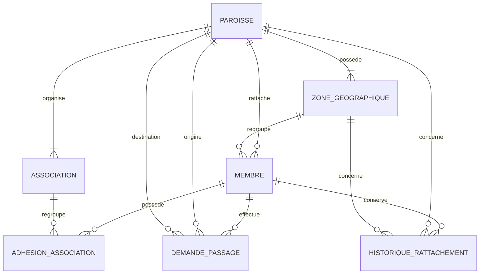
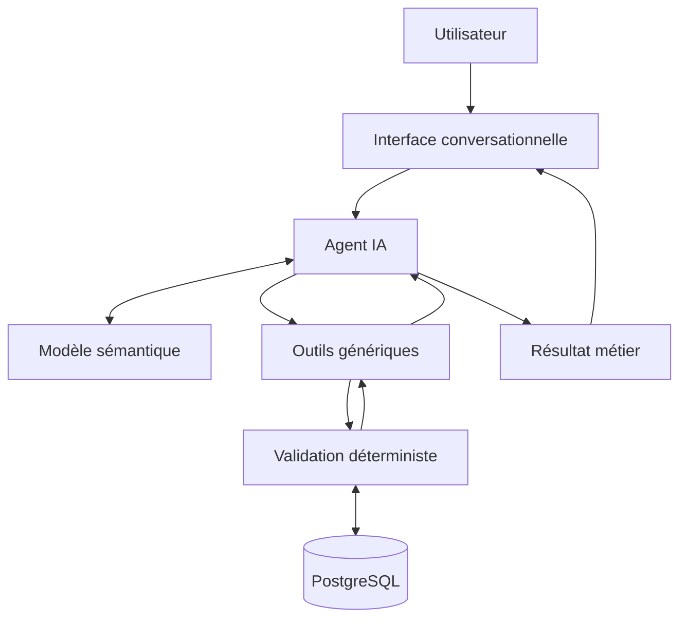

# Axora — Modèle de données initial et modèle sémantique

**Version :** 0.2
**Statut :** Modèle initial consolidé pour le prototype
**Domaine pilote :** Gestion paroissiale
**Base de données :** PostgreSQL
**Backend envisagé :** Symfony 7

---

## 1. Objectif

Ce document définit le modèle métier initial du prototype IntentDB.

IntentDB explore une approche dans laquelle un utilisateur exprime son besoin en langage naturel et un agent IA s'appuie sur un modèle métier explicite pour interpréter la demande, découvrir les données pertinentes et proposer ou exécuter une opération générique.

Deux modèles complémentaires sont nécessaires :

- **Modèle de données :** décrit comment les informations métier sont stockées et reliées.

- **Modèle sémantique :** décrit la signification métier des concepts, de leurs attributs, de leurs relations et des règles qui leur sont applicables.


L'objectif est de tester si une application peut répondre à des demandes métier qui n'ont pas été codées individuellement comme des fonctionnalités spécifiques.

## 2. Principes de conception

1. **Base relationnelle classique :** utiliser PostgreSQL et des tables relationnelles explicites pour le modèle initial.

2. **Séparation du métier et du moteur :** ne pas enfermer les règles métier uniquement dans les instructions de l'agent IA.

3. **Métadonnées explicites :** permettre à l'agent de découvrir les concepts, attributs, relations et règles.

4. **Validation déterministe :** le backend valide et exécute les opérations proposées par l'agent.

5. **Évolution contrôlée :** toute modification du modèle doit être validée avant son application.

6. **Traçabilité :** conserver les changements de rattachement afin de pouvoir interroger l'historique.

7. **Adhésions multiples :** un membre peut appartenir simultanément à plusieurs associations, sous réserve des règles métier.

8. **Absence de surconception :** ne pas ajouter de mécanismes complexes qui ne sont pas nécessaires au prototype.


La gestion avancée des permissions par rôle est hors périmètre de cette première expérimentation. Les opérations doivent néanmoins être validées par le backend.

---

## 3. Périmètre métier

### 3.1. Paroisse

Une paroisse, également appelée église dans le vocabulaire utilisé ici, regroupe des membres et organise des zones géographiques ainsi que des associations.

Exemple : la paroisse Andranovelona comprend six zones géographiques :

- Andranovelona

- Analamanga

- Ifarihy

- Ankaraobato

- Anjomakely

- Andoharanofotsy


Chaque paroisse doit disposer des quatre associations standard définies dans ce document.

### 3.2. Zone géographique

Une zone géographique appartient à une seule paroisse.

Chaque membre est rattaché à une seule zone de sa paroisse. La zone correspond à celle qui est la plus proche du domicile du membre.

Le modèle doit empêcher qu'un membre soit rattaché à une zone appartenant à une autre paroisse.

### 3.3. Membre

Un membre possède notamment :

- un identifiant unique ;

- un nom ;

- un prénom ;

- une adresse ;

- un sexe ;

- une date de naissance ;

- un statut matrimonial ;

- une paroisse de rattachement ;

- une zone géographique de rattachement ;

- des adhésions à une ou plusieurs associations.


Les valeurs définies pour le sexe sont `HOMME` et `FEMME`.

Les valeurs matrimoniales actuellement définies sont `CELIBATAIRE` et `MARIE`. Les termes « jeune » et « École du Sabbat » ne sont pas des statuts matrimoniaux : ils correspondent respectivement à une catégorie métier et à une association.

Chaque membre possède un identifiant unique dans la plateforme. Les règles complémentaires permettant de détecter les doublons de personnes restent à préciser.

### 3.4. Associations standard

Chaque paroisse doit disposer des quatre associations suivantes :

|Code|Nom|Description|
|---|---|---|
|`HOMMES`|Association des Hommes|Association des hommes|
|`FEMMES`|Association des Femmes|Association des femmes|
|`JEUNES`|Association des Jeunes|Association des jeunes membres|
|`ECOLE_SABBAT`|École du Sabbat|Association obligatoire pour les enfants de moins de 16 ans|

D'autres associations pourront être ajoutées ultérieurement.

Un membre peut appartenir à plusieurs associations simultanément. L'adhésion à l'Association des Jeunes n'exclut donc pas l'adhésion à l'Association des Hommes ou des Femmes.

Les règles d'incompatibilité suivantes doivent être respectées :

- Un homme ne peut pas adhérer à l'Association des Femmes.

- Une femme ne peut pas adhérer à l'Association des Hommes.


### 3.5. Règles d'adhésion selon l'âge et le statut matrimonial

Un membre est considéré comme jeune s'il n'est pas marié, quel que soit son âge.

Les règles d'adhésion obligatoire sont les suivantes :

|Condition du membre|Adhésion obligatoire|
|---|---|
|Âgé de moins de 16 ans|École du Sabbat|
|Non marié et âgé de 16 ans ou plus|Association des Jeunes|
|Marié, âgé de 16 ans ou plus et de sexe masculin|Association des Hommes|
|Marié, âgé de 16 ans ou plus et de sexe féminin|Association des Femmes|

Un jeune peut également adhérer à l'Association des Hommes ou des Femmes selon son sexe. Son adhésion à l'Association des Jeunes n'a pas à être supprimée pour cela.

L'âge est calculé à partir de la date de naissance au moment où la règle est évaluée. Il ne doit pas être stocké comme une valeur indépendante.

La logique métier de base est :

```
SI age < 16
    ALORS adhésion obligatoire à ECOLE_SABBAT

SINON SI statut_matrimonial = CELIBATAIRE
    ALORS adhésion obligatoire à JEUNES

SINON SI statut_matrimonial = MARIE
    ET sexe = HOMME
    ALORS adhésion obligatoire à HOMMES

SINON SI statut_matrimonial = MARIE
    ET sexe = FEMME
    ALORS adhésion obligatoire à FEMMES
```

Cette logique définit les obligations d'adhésion. Elle n'interdit pas les adhésions supplémentaires compatibles avec les règles métier.

Le cas des membres de moins de 16 ans et leurs éventuelles adhésions supplémentaires reste à préciser.

### 3.6. Passage temporaire dans une autre paroisse

Un membre qui souhaite participer au culte du sabbat dans une autre paroisse doit effectuer une demande de passage.

Le processus décrit comprend les étapes suivantes :

1. La demande est signée par le comité de la paroisse d'origine.

2. Elle est également signée par le Loholona de la paroisse d'origine.

3. Le membre présente la demande au comité de la paroisse de destination.


La demande doit indiquer la période prévue du passage, notamment sa date de début et sa date de fin.

Les informations relatives aux signataires doivent inclure leur nom.

Un passage temporaire ne modifie pas le rattachement habituel du membre à sa paroisse et à sa zone.

Les statuts détaillés, les règles de validation finale et la gestion d'une demande refusée ou annulée restent à préciser.

### 3.7. Historique des rattachements

Les changements de paroisse et de zone doivent être conservés dans la plateforme.

Il doit être possible d'interroger l'historique afin de répondre à des questions comme :

- Dans quelle paroisse ce membre était-il rattaché à une date donnée ?

- Dans quelle zone se trouvait-il avant son changement de rattachement ?

- Quels membres ont changé de zone pendant une période donnée ?


Les anciennes affectations ne doivent donc pas être simplement écrasées sans conservation de leur historique.

---

## 4. Modèle de données initial

### 4.1. Entités

|Entité|Responsabilité|
|---|---|
|`paroisse`|Identité de chaque paroisse|
|`zone_geographique`|Zones géographiques d'une paroisse|
|`membre`|Informations du membre et rattachement actuel|
|`association`|Associations organisées par paroisse|
|`adhesion_association`|Adhésions des membres aux associations|
|`demande_passage`|Demandes de passage temporaire entre paroisses|
|`historique_rattachement`|Historique des changements de paroisse et de zone|

### 4.2. Diagramme relationnel



Ce diagramme représente les relations générales. Les règles métier détaillées doivent également être validées par le backend.

### 4.3. Dictionnaire des données

#### Table `paroisse`

|Champ|Type|Obligatoire|Description|
|---|---|---|---|
|`id`|UUID|Oui|Identifiant unique|
|`nom`|VARCHAR(150)|Oui|Nom de la paroisse|

Le nom est unique dans cette version initiale.

#### Table `zone_geographique`

|Champ|Type|Obligatoire|Description|
|---|---|---|---|
|`id`|UUID|Oui|Identifiant unique|
|`paroisse_id`|UUID|Oui|Paroisse propriétaire|
|`nom`|VARCHAR(150)|Oui|Nom de la zone|

Le nom d'une zone est unique au sein de sa paroisse.

#### Table `membre`

|Champ|Type|Obligatoire|Description|
|---|---|---|---|
|`id`|UUID|Oui|Identifiant unique|
|`paroisse_id`|UUID|Oui|Paroisse de rattachement actuel|
|`zone_geographique_id`|UUID|Oui|Zone de rattachement actuelle|
|`nom`|VARCHAR(150)|Oui|Nom de famille|
|`prenom`|VARCHAR(150)|Oui|Prénom|
|`adresse`|TEXT|Non|Adresse habituelle|
|`sexe`|VARCHAR(30)|Oui|`HOMME` ou `FEMME`|
|`date_naissance`|DATE|Oui|Date de naissance|
|`statut_matrimonial`|VARCHAR(30)|Oui|`CELIBATAIRE` ou `MARIE`|

La zone sélectionnée doit appartenir à la même paroisse que le membre.

#### Table `association`

|Champ|Type|Obligatoire|Description|
|---|---|---|---|
|`id`|UUID|Oui|Identifiant unique|
|`paroisse_id`|UUID|Oui|Paroisse organisatrice|
|`nom`|VARCHAR(150)|Oui|Nom de l'association|
|`code`|VARCHAR(50)|Oui|Code d'identification|

Les codes des quatre associations standard sont `HOMMES`, `FEMMES`, `JEUNES` et `ECOLE_SABBAT`.

#### Table `adhesion_association`

|Champ|Type|Obligatoire|Description|
|---|---|---|---|
|`id`|UUID|Oui|Identifiant unique|
|`membre_id`|UUID|Oui|Membre concerné|
|`association_id`|UUID|Oui|Association concernée|
|`date_adhesion`|DATE|Oui|Date de début d'adhésion|

La combinaison `membre_id` et `association_id` est unique pour empêcher les doublons d'adhésion active dans ce modèle initial.

Cette table permet à un membre d'adhérer simultanément à plusieurs associations.

#### Table `demande_passage`

|Champ|Type|Obligatoire|Description|
|---|---|---|---|
|`id`|UUID|Oui|Identifiant unique|
|`membre_id`|UUID|Oui|Membre demandeur|
|`paroisse_origine_id`|UUID|Oui|Paroisse d'origine|
|`paroisse_destination_id`|UUID|Oui|Paroisse de destination|
|`date_demande`|DATE|Oui|Date de la demande|
|`date_debut_passage`|DATE|Oui|Début prévu du passage|
|`date_fin_passage`|DATE|Oui|Fin prévue du passage|
|`nom_signataire_comite`|VARCHAR(200)|Oui|Nom du signataire du comité d'origine|
|`nom_signataire_loholona`|VARCHAR(200)|Oui|Nom du signataire Loholona|
|`presentee_au_comite_destination`|BOOLEAN|Oui|Indique si la demande a été présentée au comité de destination|
|`statut`|VARCHAR(30)|Oui|État de la demande|

Les noms des signataires constituent les informations nominatives minimales définies pour le prototype. La preuve numérique d'une signature n'est pas couverte par ce modèle.

#### Table `historique_rattachement`

|Champ|Type|Obligatoire|Description|
|---|---|---|---|
|`id`|UUID|Oui|Identifiant unique|
|`membre_id`|UUID|Oui|Membre concerné|
|`ancienne_paroisse_id`|UUID|Non|Ancienne paroisse|
|`ancienne_zone_id`|UUID|Non|Ancienne zone|
|`nouvelle_paroisse_id`|UUID|Oui|Nouvelle paroisse|
|`nouvelle_zone_id`|UUID|Oui|Nouvelle zone|
|`date_effet`|DATE|Oui|Date d'effet du changement|

Cette structure constitue une base minimale pour interroger les changements. Les dates de fin, les motifs et les règles de conservation pourront être ajoutés si les scénarios le nécessitent.

---

## 5. Schéma SQL initial

Le SQL suivant propose un socle PostgreSQL pour le prototype. Les UUID sont générés par l'application ou par un mécanisme de génération configuré.

```sql
CREATE TABLE paroisse (
    id UUID PRIMARY KEY,
    nom VARCHAR(150) NOT NULL UNIQUE
);

CREATE TABLE zone_geographique (
    id UUID PRIMARY KEY,
    paroisse_id UUID NOT NULL REFERENCES paroisse(id),
    nom VARCHAR(150) NOT NULL,

    UNIQUE (paroisse_id, nom),
    UNIQUE (id, paroisse_id)
);

CREATE TABLE membre (
    id UUID PRIMARY KEY,
    paroisse_id UUID NOT NULL REFERENCES paroisse(id),
    zone_geographique_id UUID NOT NULL,

    nom VARCHAR(150) NOT NULL,
    prenom VARCHAR(150) NOT NULL,
    adresse TEXT,
    sexe VARCHAR(30) NOT NULL
        CHECK (sexe IN ('HOMME', 'FEMME')),
    date_naissance DATE NOT NULL,
    statut_matrimonial VARCHAR(30) NOT NULL
        CHECK (statut_matrimonial IN ('CELIBATAIRE', 'MARIE')),

    FOREIGN KEY (zone_geographique_id, paroisse_id)
        REFERENCES zone_geographique(id, paroisse_id)
);

CREATE TABLE association (
    id UUID PRIMARY KEY,
    paroisse_id UUID NOT NULL REFERENCES paroisse(id),
    nom VARCHAR(150) NOT NULL,
    code VARCHAR(50) NOT NULL,

    UNIQUE (paroisse_id, code)
);

CREATE TABLE adhesion_association (
    id UUID PRIMARY KEY,
    membre_id UUID NOT NULL REFERENCES membre(id),
    association_id UUID NOT NULL REFERENCES association(id),
    date_adhesion DATE NOT NULL,

    UNIQUE (membre_id, association_id)
);

CREATE TABLE demande_passage (
    id UUID PRIMARY KEY,
    membre_id UUID NOT NULL REFERENCES membre(id),
    paroisse_origine_id UUID NOT NULL REFERENCES paroisse(id),
    paroisse_destination_id UUID NOT NULL REFERENCES paroisse(id),

    date_demande DATE NOT NULL,
    date_debut_passage DATE NOT NULL,
    date_fin_passage DATE NOT NULL,

    nom_signataire_comite VARCHAR(200) NOT NULL,
    nom_signataire_loholona VARCHAR(200) NOT NULL,

    presente_au_comite_destination BOOLEAN NOT NULL DEFAULT FALSE,
    statut VARCHAR(30) NOT NULL,

    CHECK (paroisse_origine_id <> paroisse_destination_id),
    CHECK (date_fin_passage >= date_debut_passage)
);

CREATE TABLE historique_rattachement (
    id UUID PRIMARY KEY,
    membre_id UUID NOT NULL REFERENCES membre(id),

    ancienne_paroisse_id UUID REFERENCES paroisse(id),
    ancienne_zone_id UUID REFERENCES zone_geographique(id),

    nouvelle_paroisse_id UUID NOT NULL REFERENCES paroisse(id),
    nouvelle_zone_id UUID NOT NULL REFERENCES zone_geographique(id),

    date_effet DATE NOT NULL
);
```

### 5.1. Contraintes métier complémentaires

Les contrôles suivants doivent être réalisés dans le backend et, lorsque cela est pertinent, par des contraintes de base de données :

1. Présence des quatre associations standard dans chaque paroisse.

2. Compatibilité entre le sexe et les associations Hommes ou Femmes.

3. Adhésion obligatoire à l'École du Sabbat avant 16 ans.

4. Adhésion obligatoire à l'Association des Jeunes à partir de 16 ans pour les membres non mariés.

5. Adhésion obligatoire à l'Association des Hommes ou des Femmes à partir de 16 ans pour les membres mariés, selon le sexe.

6. Cohérence entre la paroisse du membre et la paroisse d'origine de sa demande de passage.

7. Cohérence entre les zones et leurs paroisses dans l'historique des rattachements.

8. Conservation de l'historique lors des changements de paroisse ou de zone.

9. Validation des dates et des statuts d'une demande de passage.


La présence obligatoire des associations et les règles d'adhésion conditionnelles nécessitent une validation métier dédiée. Elles ne sont pas garanties par les seules clés étrangères.

La détection des doublons de personnes reste également à définir : l'identifiant UUID garantit l'unicité technique de chaque enregistrement, mais pas l'absence de doublons représentant une même personne.

---

## 6. Modèle sémantique

### 6.1. Rôle du modèle sémantique

Le modèle sémantique décrit le sens métier des données et permet à l'agent IA d'interpréter les formulations en langage naturel.

Par exemple :

> Quels sont les jeunes de la paroisse Andranovelona qui appartiennent aussi à l'Association des Hommes ?

L'agent doit comprendre que :

- « jeunes » désigne les membres non mariés selon la règle métier ;

- la paroisse permet de filtrer les membres ;

- l'Association des Jeunes et l'Association des Hommes sont des associations distinctes ;

- un membre peut appartenir simultanément aux deux associations ;

- le résultat doit provenir des données réelles.


L'agent prépare un plan d'opération à partir des métadonnées. Le backend valide et exécute ce plan.

### 6.2. Structure sémantique

Chaque concept peut décrire :

- un nom stable ;

- une description métier ;

- une correspondance avec une table et des colonnes ;

- des attributs et leur signification ;

- des relations vers d'autres concepts ;

- des synonymes ;

- des règles métier ;

- les opérations génériques applicables.


Le modèle sémantique est distinct du schéma SQL, même s'il référence celui-ci.

### 6.3. Exemple de modèle sémantique YAML

Le fichier suivant est une proposition initiale. Sa structure devra être validée avant son utilisation par le backend.

```yaml
model:
  name: gestion_paroissiale
  version: "0.2"
  description: >
    Modèle sémantique initial du domaine de gestion paroissiale.

  entities:
    Paroisse:
      description: >
        Communauté ecclésiale à laquelle les membres
        sont officiellement rattachés.
      storage:
        table: paroisse
        id: id
      attributes:
        nom:
          column: nom
          type: string
          description: Nom de la paroisse
      synonyms:
        - église
        - communauté
      relationships:
        zones:
          target: ZoneGeographique
          cardinality: one-to-many
        membres:
          target: Membre
          cardinality: one-to-many
        associations:
          target: Association
          cardinality: one-to-many

    ZoneGeographique:
      description: >
        Zone géographique appartenant à une paroisse.
      storage:
        table: zone_geographique
        id: id
      attributes:
        nom:
          column: nom
          type: string
          description: Nom de la zone
      synonyms:
        - zone
        - groupe
      relationships:
        paroisse:
          target: Paroisse
          cardinality: many-to-one
        membres:
          target: Membre
          cardinality: one-to-many

    Membre:
      description: >
        Personne rattachée à une paroisse et à une zone
        géographique de cette même paroisse.
      storage:
        table: membre
        id: id
      attributes:
        nom:
          column: nom
          type: string
          description: Nom de famille
        prenom:
          column: prenom
          type: string
          description: Prénom
        adresse:
          column: adresse
          type: string
          description: Adresse habituelle
        sexe:
          column: sexe
          type: string
          allowed_values:
            - HOMME
            - FEMME
        date_naissance:
          column: date_naissance
          type: date
        statut_matrimonial:
          column: statut_matrimonial
          type: string
          allowed_values:
            - CELIBATAIRE
            - MARIE
      synonyms:
        - adhérent
        - fidèle
      relationships:
        paroisse:
          target: Paroisse
          cardinality: many-to-one
        zone:
          target: ZoneGeographique
          cardinality: many-to-one
        associations:
          target: Association
          through: adhesion_association
          cardinality: many-to-many

    Association:
      description: >
        Groupe organisé au sein d'une paroisse.
      storage:
        table: association
        id: id
      attributes:
        nom:
          column: nom
          type: string
        code:
          column: code
          type: string
      standard_types:
        - HOMMES
        - FEMMES
        - JEUNES
        - ECOLE_SABBAT
      relationships:
        paroisse:
          target: Paroisse
          cardinality: many-to-one
        membres:
          target: Membre
          through: adhesion_association
          cardinality: many-to-many

    DemandePassage:
      description: >
        Demande de participation temporaire au culte
        dans une autre paroisse.
      storage:
        table: demande_passage
        id: id
      attributes:
        date_demande:
          column: date_demande
          type: date
        date_debut_passage:
          column: date_debut_passage
          type: date
        date_fin_passage:
          column: date_fin_passage
          type: date
        statut:
          column: statut
          type: string
      relationships:
        membre:
          target: Membre
          cardinality: many-to-one
        paroisse_origine:
          target: Paroisse
          cardinality: many-to-one
        paroisse_destination:
          target: Paroisse
          cardinality: many-to-one

    HistoriqueRattachement:
      description: >
        Trace les changements de paroisse et de zone
        d'un membre dans le temps.
      storage:
        table: historique_rattachement
        id: id
      attributes:
        date_effet:
          column: date_effet
          type: date
      relationships:
        membre:
          target: Membre
          cardinality: many-to-one
        nouvelle_paroisse:
          target: Paroisse
          cardinality: many-to-one
        nouvelle_zone:
          target: ZoneGeographique
          cardinality: many-to-one

  business_rules:
    - id: BR-001
      description: >
        Chaque membre appartient à une paroisse
        et à une zone de cette même paroisse.

    - id: BR-002
      description: >
        Un membre non marié est considéré comme jeune,
        quel que soit son âge.

    - id: BR-003
      description: >
        Un membre âgé de moins de 16 ans doit adhérer
        à l'École du Sabbat.

    - id: BR-004
      description: >
        Un membre non marié âgé d'au moins 16 ans
        doit adhérer à l'Association des Jeunes.

    - id: BR-005
      description: >
        Un membre marié âgé d'au moins 16 ans doit
        adhérer à l'association correspondant à son sexe.

    - id: BR-006
      description: >
        Un homme ne peut pas adhérer à l'Association
        des Femmes et une femme ne peut pas adhérer
        à l'Association des Hommes.

    - id: BR-007
      description: >
        Les adhésions sont cumulatives lorsque les
        règles métier le permettent. Être membre de
        l'Association des Jeunes n'exclut pas l'adhésion
        à l'Association des Hommes ou des Femmes.

    - id: BR-008
      description: >
        Un passage temporaire dans une autre paroisse
        ne modifie pas le rattachement habituel du membre.

    - id: BR-009
      description: >
        Les changements de paroisse et de zone doivent
        être conservés dans l'historique.
```

### 6.4. Règles métier calculées

Les catégories métier dérivées ne doivent pas être enregistrées comme des valeurs indépendantes lorsqu'elles peuvent être calculées à partir des données existantes.

```php
est_jeune =
    statut_matrimonial == CELIBATAIRE

age =
    âge calculé à partir de date_naissance
    à la date de référence

adhesion_ecole_sabbat_obligatoire =
    age < 16

adhesion_jeunes_obligatoire =
    age >= 16
    AND est_jeune

adhesion_association_sexe_obligatoire =
    age >= 16
    AND statut_matrimonial == MARIE
```

Pour la dernière règle, le choix de l'association dépend du sexe :

```
SI adhesion_association_sexe_obligatoire
    ET sexe == HOMME
    ALORS association obligatoire = HOMMES

SI adhesion_association_sexe_obligatoire
    ET sexe == FEMME
    ALORS association obligatoire = FEMMES
```

Ces règles définissent les adhésions obligatoires. Elles ne doivent pas être interprétées comme une interdiction d'adhérer à une autre association compatible.

---

## 7. Architecture conceptuelle d'IntentDB



### Responsabilités

**Interface conversationnelle**

- Reçoit la demande de l'utilisateur.

- Présente les résultats.

- Demande des précisions si nécessaire.


**Agent IA**

- Interprète la demande.

- Consulte le modèle sémantique.

- Prépare un plan d'opération.

- Signale les ambiguïtés.

- Utilise les outils génériques disponibles.


**Modèle sémantique**

- Décrit les concepts métier.

- Relie les concepts aux données techniques.

- Expose les relations et les règles métier.

- Permet de faire évoluer la compréhension du domaine.


**Outils génériques**

- Découvrir les entités et les relations.

- Rechercher et filtrer les données.

- Relier plusieurs entités.

- Calculer des agrégats.

- Créer et modifier des données.

- Proposer des évolutions du modèle.


**Backend de validation**

- Vérifie les paramètres et les opérations.

- Applique les règles métier.

- Contrôle la cohérence des écritures.

- Exécute les opérations validées dans PostgreSQL.


L'agent ne doit pas disposer d'un accès SQL arbitraire non contrôlé. Le backend conserve la responsabilité de l'exécution effective.

---

## 8. Hypothèses et points restant à préciser

Les décisions connues sont intégrées au modèle. Les points suivants restent ouverts :

| Sujet                                                        | État                                                           |
| ------------------------------------------------------------ | -------------------------------------------------------------- |
| Adhésions supplémentaires pour les moins de 16 ans           | À préciser                                                     |
| Valeurs supplémentaires du statut matrimonial                | Non définies                                                   |
| Détection des doublons de personnes                          | Critères à définir                                             |
| Statuts et transitions détaillés d'une demande de passage    | À préciser                                                     |
| Date de fin et durée des adhésions associatives              | À préciser                                                     |
| Motif d'un changement de paroisse ou de zone                 | À préciser                                                     |
| Conservation des anciennes affectations et dates de validité | À préciser plus finement                                       |
| Modalités de vérification des signatures                     | Le nom du signataire est requis ; preuve numérique non définie |
| Gestion des permissions par rôle                             | Hors périmètre du prototype                                    |

Ces éléments ne doivent pas être inventés par l'agent IA. Ils pourront être définis lorsque les scénarios expérimentaux en auront besoin.

---

## 9. Critères de validation du modèle

Le modèle sera considéré comme suffisamment prêt pour les premières expérimentations lorsque :

- Les entités principales sont définies.

- Chaque membre est rattaché à une paroisse et à une zone de cette paroisse.

- Les quatre associations standard sont identifiées.

- Les adhésions multiples sont prises en charge.

- Les règles d'adhésion selon l'âge, le statut matrimonial et le sexe sont explicites.

- Les demandes de passage conservent les signataires et la période prévue.

- Les changements de rattachement sont historisés.

- Les métadonnées sémantiques peuvent être chargées et validées par le backend.

- Les règles métier sont testables indépendamment de l'agent IA.

- Un jeu de données réaliste permet de tester les premières demandes en langage naturel.


---

## 10. Prochaine étape

Après validation de ce document, la prochaine étape est de définir le **contrat entre l'agent IA et le backend Symfony**.

Ce contrat devra préciser :

1. Les outils génériques disponibles.

2. Les paramètres et les résultats de chaque outil.

3. Le format du plan d'opération proposé par l'agent.

4. Les validations réalisées par le backend.

5. Le mécanisme d'exécution des requêtes PostgreSQL.

6. La gestion des erreurs et des demandes ambiguës.

7. Le mécanisme de proposition et de validation des modifications du modèle.


Le premier test fonctionnel pourra être :

> Qui sont les membres de la paroisse Andranovelona qui habitent dans la zone d'Andoharanofotsy ?

L'agent devra découvrir les concepts et relations nécessaires, construire un plan de lecture valide et obtenir une réponse à partir des données réelles, sans fonctionnalité codée spécifiquement pour cette question.

Un test ultérieur pourra vérifier l'évolution du modèle : ajout d'un nouveau concept métier, puis interrogation de ce concept sans développement d'une fonctionnalité dédiée.

---

**Fin du document — IntentDB, modèle de données initial et modèle sémantique, version 0.2.**
