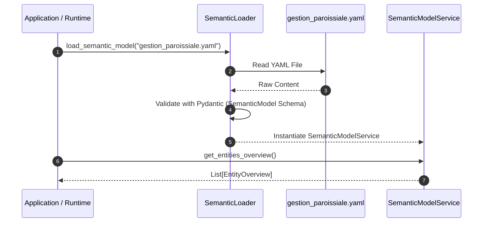
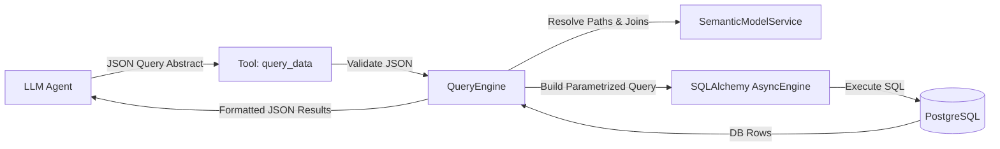
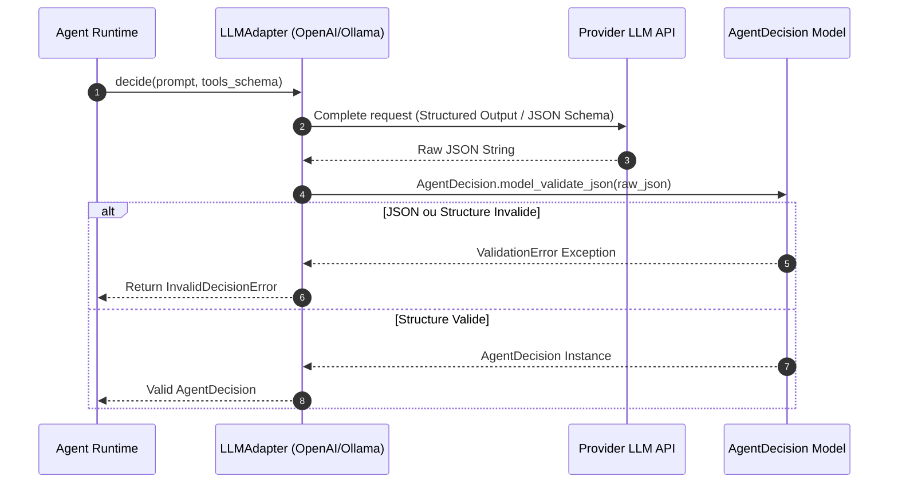
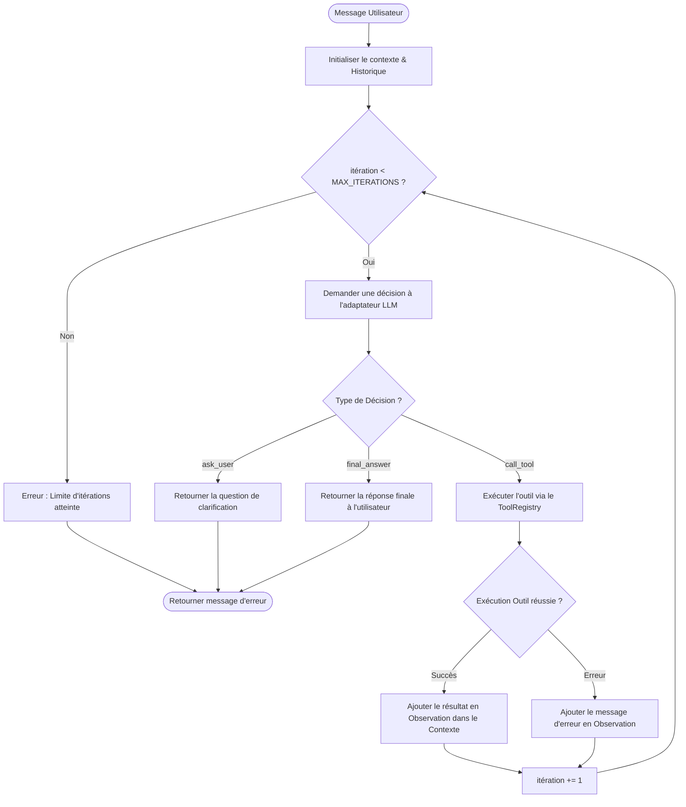
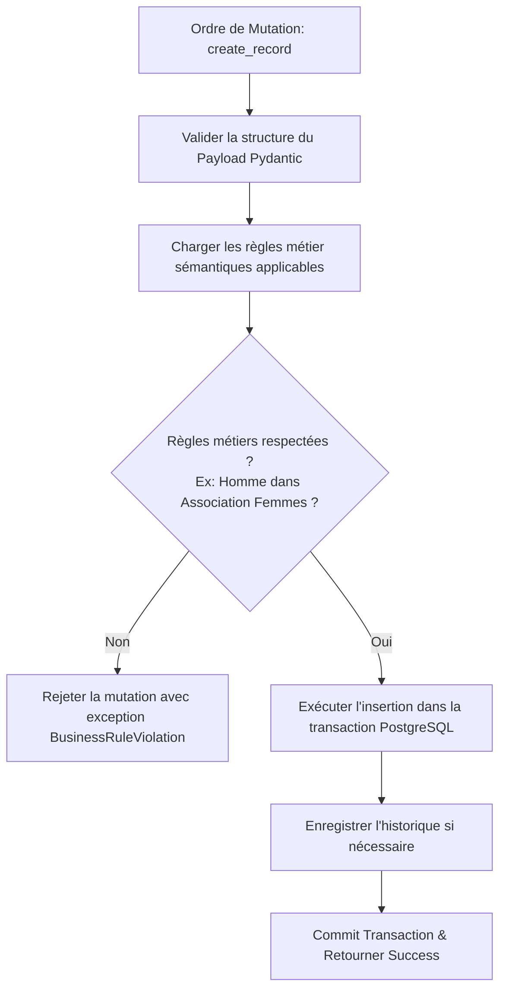

# Axora — Spécifications Techniques & Spécifications des Fonctionnalités

**Version :** 0.4
**Statut :** Spécifications détaillées des fonctionnalités de l'agent Axora
**Langage :** Python 3.12 (FastAPI, Pydantic v2, SQLAlchemy 2.0 Async)
**Base de données :** PostgreSQL 17

---

## 1. Vue d'ensemble des Fonctionnalités à Développer

| ID Feature | Nom de la Fonctionnalité | Description Synthétique | Module Cible |
|---|---|---|---|
| **FEAT-01** | Service de Chargement & Consultation Sémantique | Chargement du fichier YAML du modèle sémantique et mise à disposition d'une API interne d'exploration. | `src/axora/semantic/` |
| **FEAT-02** | Outil Générique de Découverte Sémantique (`discover_model`) | Outil utilisable par le LLM pour découvrir progressivement les entités, attributs et relations métier. | `src/axora/tools/discover_model.py` |
| **FEAT-03** | Moteur de Requête Dynamique & Outil `query_data` | Traducteur de requêtes sémantiques abstraites vers des requêtes SQL SQLAlchemy paramétrées et sécurisées. | `src/axora/data/query_engine.py` & `src/axora/tools/query_data.py` |
| **FEAT-04** | Adaptateur LLM Interne & Contrat Pydantic Stricte | Interface d'abstraction des modèles de langage avec validation stricte des décisions par Pydantic. | `src/axora/llm/` & `src/axora/agent/decisions.py` |
| **FEAT-05** | Boucle d'Exécution Bornée & Orchestrateur Agent | Runtime de contrôle en Python exécutant la boucle itérative (Prompt -> Décision -> Tool Execution -> Observation). | `src/axora/agent/loop.py` & `runtime.py` |
| **FEAT-06** | Moteur de Mutation Sécurisé (`create_record` & `update_record`) | Validation des règles métier complexes et exécution des modifications en base de données. | `src/axora/data/mutation_engine.py` & `src/axora/tools/` |
| **FEAT-07** | Endpoint API Chat / Conversationnel | Exposition de l'agent via des endpoints HTTP FastAPI et gestion du contexte conversationnel persistant. | `src/axora/api/routes.py` & `src/axora/conversations/` |

---

## 2. Spécifications Techniques Détaillées par Fonctionnalité

---

### FEAT-01 : Service de Chargement & Consultation Sémantique

#### Description Technique
Le service sémantique est la source de vérité de l'application concernant la signification du domaine métier. Il charge `gestion_paroissiale.yaml` et expose des méthodes rapides d'inspection.

#### Diagramme de Séquence (Chargement & Consultation)


#### Règles à Respecter :
1. **Validation Stricte au Démarrage :** Tout fichier sémantique YAML doit être entièrement validé au démarrage de l'application via un schéma Pydantic (`SemanticModel`). Si le YAML contient des erreurs de structure, l'application doit refuser de démarrer.
2. **Immutabilité en Moteur :** Le modèle sémantique chargé est en lecture seule pendant l'exécution d'une requête utilisateur.

---

### FEAT-02 : Outil Générique de Découverte Sémantique (`discover_model`)

#### Description Technique
Cet outil permet à l'agent LLM d'explorer le domaine de façon incrémentale lorsqu'il reçoit une demande utilisateur.

#### Diagramme de Flux de Décision
```mermaid
flowchart TD
    A[Appel de discover_model par le LLM] --> B{Arguments fournis ?}
    B -- concept="Membre" --> C[Récupérer attributs & relations de Membre]
    B -- Sans argument --> D[Retourner la vue d'ensemble de toutes les entités]
    B -- include=["rules"] --> E[Injecter les business_rules associées]
    C --> F[Formater le JSON de réponse ToolResult]
    D --> F
    E --> F
    F --> G[Renvoyer au Runtime Agent]
```

#### Règles à Respecter :
1. **Économie de Tokens :** Ne pas renvoyer l'intégralité du modèle sémantique en une seule fois au LLM. Répondre uniquement avec la profondeur d'information demandée (`overview`, `concept_details`, `relationships`).
2. **Gestion des Concepts Inconnus :** Si le LLM demande un concept non existant (ex: `Chorale`), l'outil doit retourner une erreur claire sans planter : `"Concept 'Chorale' inconnu dans le modèle sémantique."`

---

### FEAT-03 : Moteur de Requête Dynamique & Outil `query_data`

#### Description Technique
`query_data` est le cœur de la consultation de données. Le moteur traduit une structure de requête abstraite JSON en requête SQL paramétrée SQLAlchemy.

#### Diagramme d'Architecture du Moteur de Requête


#### Exemple de contrat JSON de `query_data` :
```json
{
  "entity": "Membre",
  "select": ["id", "nom", "prenom"],
  "filters": [
    {"path": "paroisse.nom", "operator": "equals", "value": "Andranovelona"},
    {"path": "zone.nom", "operator": "equals", "value": "Andoharanofotsy"}
  ],
  "limit": 50
}
```

#### Règles à Respecter :
1. **Interdiction de SQL Brut :** Le LLM ne doit pas envoyer de chaînes SQL. Tout passe par la structure AST / JSON du contrat de filtre.
2. **Requêtes Paramétrées Obligatoires :** Utiliser exclusivement des clauses `where()` SQLAlchemy paramétrées pour prévenir tout risque d'injection SQL.
3. **Limites de Sécurité :** Appliquer systématiquement une limite maximale sur le nombre de résultats retournés (`limit` par défaut = 50, `max_limit` = 200).

---

### FEAT-04 : Adaptateur LLM Interne & Contrat Pydantic Stricte

#### Description Technique
L'adaptateur masque les spécificités des fournisseurs (OpenAI, Anthropic, Ollama) et garantit que chaque réponse du LLM est convertie en une instance valide de `AgentDecision`.

#### Diagramme de Séquence de Validation de Décision


#### Règles à Respecter :
1. **Contrat Pydantic Invariable :** `type` doit être restreint à `"call_tool"`, `"ask_user"`, ou `"final_answer"`.
2. **Isolation des SDKs :** Les bibliothèques clientes des fournisseurs LLM (ex: `openai`, `anthropic`) ne doivent jamais être importées en dehors du dossier `src/axora/llm/`.

---

### FEAT-05 : Boucle d'Exécution Bornée & Orchestrateur Agent

#### Description Technique
Le Runtime Python orchestre les étapes de la conversation et contrôle la boucle itérative.

#### Diagramme de Flux de la Boucle d'Exécution (`loop.py`)


#### Règles à Respecter :
1. **Garantie d'Arrêt :** La boucle doit avoir une borne supérieure stricte (`MAX_AGENT_ITERATIONS` = 8 par défaut).
2. **Auto-correction des Erreurs :** Si un outil renvoie une erreur (ex: arguments invalides), l'erreur est transmise au LLM comme observation afin qu'il tente de corriger sa décision au tour suivant.

---

### FEAT-06 : Moteur de Mutation Sécurisé (`create_record` & `update_record`)

#### Description Technique
Ce moteur permet d'exécuter des créations et mises à jour en s'assurant que toutes les règles métier (âge, statut matrimonial, incompatibilités) sont vérifiées avant validation.

#### Diagramme de Traitement d'une Mutation


#### Règles à Respecter :
1. **Transactionnalité :** Toute écriture s'effectue au sein d'une transaction SQLAlchemy atomique (`async with session.begin():`).
2. **Validation Métier Backend Obligatoire :** Ne pas se fier à la bonne volonté du LLM. Le backend valide explicitement les contraintes métier (ex: vérification que l'âge < 16 impose l'association École du Sabbat).

---

### FEAT-07 : Endpoint API Chat / Conversationnel

#### Description Technique
L'interface HTTP FastAPI permettant d'échanger avec l'agent et de conserver les sessions conversationnelles.

#### Contrat de l'Endpoint REST :
- **Route :** `POST /api/v1/chat`
- **Request Body :**
  ```json
  {
    "conversation_id": "3fa85f64-5717-4562-b3fc-2c963f66afa6",
    "message": "Qui sont les membres de la paroisse Andranovelona qui habitent dans la zone d'Andoharanofotsy ?"
  }
  ```
- **Response Body :**
  ```json
  {
    "conversation_id": "3fa85f64-5717-4562-b3fc-2c963f66afa6",
    "response": "J'ai trouvé 12 membres correspondant à votre demande dans la zone d'Andoharanofotsy.",
    "status": "completed"
  }
  ```

#### Règles à Respecter :
1. **Asynchronisme Complet :** Utiliser des routes FastAPI `async def`.
2. **Persistance du Contexte :** Sauvegarder chaque message (utilisateur, agent, appels d'outils) dans la table PostgreSQL des conversations.

---

**Axora — From intent to action.**
