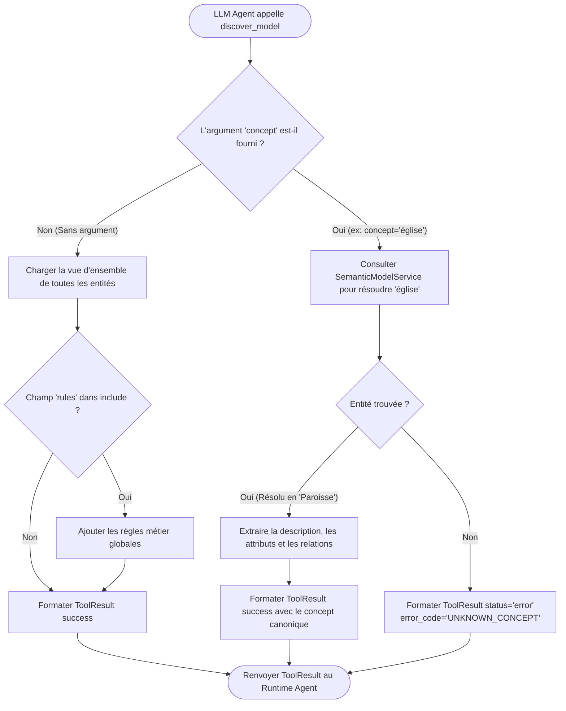

# Axora — FEAT-02 : Spécifications & Documentation Technique de l'Outil `discover_model`

**Version :** 0.6
**Statut :** Documentation technique détaillée de la fonctionnalité FEAT-02
**Composants :** `src/axora/tools/` (`interface.py`, `registry.py`, `discover_model.py`)

---

## 1. Présentation de FEAT-02

FEAT-02 fournit le contrat d'interface générique des outils agentiques (`ToolInterface`), le registre centralisé (`ToolRegistry`), ainsi que l'implémentation de l'outil `discover_model`.

L'outil `discover_model` permet à l'agent LLM d'explorer dynamiquement les métadonnées sémantiques du domaine métier au cours de sa boucle d'exécution (découverte progressive d'entités, attributs, relations, règles métier et synonymes).

---

## 2. Architecture & Composants

```text
src/axora/tools/
├── __init__.py
├── interface.py          # Protocole ToolInterface et modèle Pydantic ToolResult
├── registry.py           # ToolRegistry (enregistrement, recherche, exportation JSON Schema)
└── discover_model.py     # Implémentation de l'outil discover_model
```

### 2.1 Contrat de résultat d'un Outil (`ToolResult`)

Chaque outil doit obligatoirement retourner une structure Pydantic `ToolResult` :

```python
class ToolResult(BaseModel):
    status: Literal["success", "error"]
    data: Any = None
    error_code: str | None = None
    message: str | None = None
    metadata: dict[str, Any] = Field(default_factory=dict)
```

---

## 3. Schéma JSON des Paramètres de `discover_model`

L'outil exporte le schéma JSON suivant à destination du LLM :

```json
{
  "type": "function",
  "function": {
    "name": "discover_model",
    "description": "Explore the semantic business model. Retrieve information about available entities, their attributes, relationships, synonyms, or business rules.",
    "parameters": {
      "type": "object",
      "properties": {
        "concept": {
          "type": "string",
          "description": "Optional concept name or synonym to inspect (e.g. 'Membre', 'Paroisse', 'église'). If omitted, returns an overview of all concepts."
        },
        "include": {
          "type": "array",
          "items": {
            "type": "string",
            "enum": ["attributes", "relationships", "rules"]
          },
          "description": "Optional aspects to include in detail for a concept query."
        }
      },
      "required": []
    }
  }
}
```

---

## 4. Diagramme de Flux d'Exécution de `discover_model`



---

## 5. Exemples d'Utilisation et Réponses JSON

### Exemple 1 : Demande d'aperçu général (`concept` omis)

**Appel par l'agent :**
```json
{
  "name": "discover_model",
  "arguments": {}
}
```

**Réponse de l'outil (`ToolResult.data`) :**
```json
{
  "model_name": "gestion_paroissiale",
  "version": "0.2",
  "entities": [
    {
      "name": "Paroisse",
      "description": "Communauté ecclésiale à laquelle les membres sont officiellement rattachés.",
      "synonyms": ["église", "communauté"]
    },
    {
      "name": "Membre",
      "description": "Personne rattachée à une paroisse et à une zone géographique de cette même paroisse.",
      "synonyms": ["adhérent", "fidèle"]
    }
  ],
  "business_rules": []
}
```

### Exemple 2 : Inspection d'un synonyme (`concept="église"`)

**Appel par l'agent :**
```json
{
  "name": "discover_model",
  "arguments": {
    "concept": "église",
    "include": ["attributes", "relationships"]
  }
}
```

**Réponse de l'outil (`ToolResult.data`) :**
```json
{
  "concept": "Paroisse",
  "description": "Communauté ecclésiale à laquelle les membres sont officiellement rattachés.",
  "synonyms": ["église", "communauté"],
  "attributes": {
    "nom": {
      "column": "nom",
      "type": "string",
      "description": "Nom de la paroisse"
    }
  },
  "relationships": {
    "zones": {
      "target": "ZoneGeographique",
      "cardinality": "one-to-many"
    },
    "membres": {
      "target": "Membre",
      "cardinality": "one-to-many"
    }
  }
}
```

---

## 6. Validation par les Tests Unitaires

La suite de tests unitaires dans `tests/test_discover_model_tool.py` couvre 100% des cas d'usage :
1. Extraction des métadonnées et du schéma JSON de l'outil.
2. Exécution sans arguments (vue d'ensemble).
3. Inspection d'un concept exact (`Membre`).
4. Résolution automatique d'un synonyme (`église` -> `Paroisse`).
5. Traitement d'un concept inconnu (retour d'une erreur structurée `UNKNOWN_CONCEPT`).
6. Enregistrement, doublons et gestion des erreurs du `ToolRegistry`.

**Commande d'exécution :**
```bash
PYTHONPATH=src python3 -m pytest tests/test_discover_model_tool.py
```

---

**Axora — From intent to action.**
