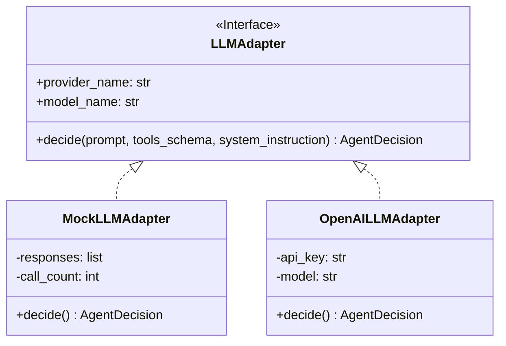
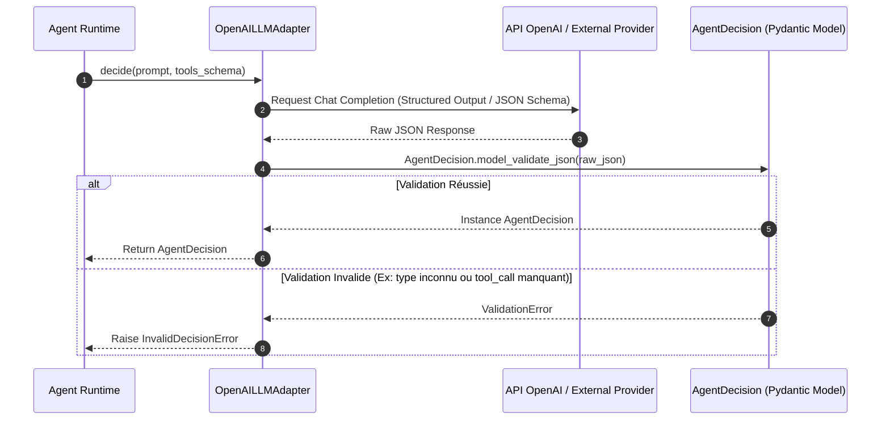

# Axora — FEAT-04 : Spécifications & Documentation Technique des Adaptateurs LLM (`LLMAdapter`) et des Décisions Structurées Pydantic

**Version :** 0.8
**Statut :** Documentation technique détaillée de FEAT-04
**Composants :** `src/axora/llm/` (`interface.py`, `provider.py`), `src/axora/agent/decisions.py`

---

## 1. Présentation de FEAT-04

FEAT-04 isole l intégration avec les modèles de langage (LLM) derrière un adaptateur abstrait et déterministe (`LLMAdapter`).

Il garantit que :
1. **L application reste totalement indépendante du fournisseur LLM** (OpenAI, Anthropic, Ollama, Mock).
2. **Chaque réponse du modèle est strictement validée par Pydantic** selon le modèle `AgentDecision`.
3. **Le runtime Python et la boucle d exécution reçoivent un objet fortement typé**, éliminant tout risque d erreur de parsing JSON sauvage.

---

## 2. Contrat de Décision Structurée (`AgentDecision`)

Le contrat de décision est l unique structure de contrôle émise par le LLM.

```python
class ToolCall(BaseModel):
    name: str
    arguments: dict[str, Any] = Field(default_factory=dict)

class AgentDecision(BaseModel):
    type: Literal["call_tool", "ask_user", "final_answer"]
    tool_call: ToolCall | None = None
    content: str | None = None
```

### Règles de Validation Pydantic Stricte :
- **`type == "call_tool"`** : Exige la présence obligatoire d un payload `tool_call` valide.
- **`type == "ask_user"`** : Exige la présence obligatoire d une question texte dans `content`.
- **`type == "final_answer"`** : Exige la présence obligatoire d une réponse texte dans `content`.

---

## 3. Architecture des Adaptateurs LLM

### Diagramme de Classe et d Abstraction



---

## 4. Diagramme de Séquence de Validation d une Décision



---

## 5. Exemples d Utilisation en Code Python

```python
from axora.llm.provider import get_llm_adapter

# 1. Instancier l adaptateur via la factory selon la configuration (.env)
adapter = get_llm_adapter("openai")

# 2. Invoquer de façon asynchrone la méthode decide()
decision = await adapter.decide("Lister les membres de la paroisse Andranovelona")

# 3. Traiter la décision déterministe
if decision.type == "call_tool":
    print(f"Outil demandé: {decision.tool_call.name}")
    print(f"Arguments: {decision.tool_call.arguments}")
elif decision.type == "final_answer":
    print(f"Réponse finale: {decision.content}")
```

---

## 6. Validation par les Tests Unitaires

La suite de tests unitaires dans `tests/test_llm_adapter.py` vérifie :
1. Le comportement par défaut du `MockLLMAdapter`.
2. Le déclenchement automatique sur mots-clés (`paroisse`, `membre`).
3. La relecture d une séquence prédéfinie de décisions pour les tests d intégration E2E.
4. La bascule de sécurité (fallback) du `OpenAILLMAdapter` en l absence de clé valide.
5. La fabrique `get_llm_adapter()`.

**Commande d exécution :**
```bash
PYTHONPATH=src python3 -m pytest tests/test_llm_adapter.py
```

---

**Axora — From intent to action.**
