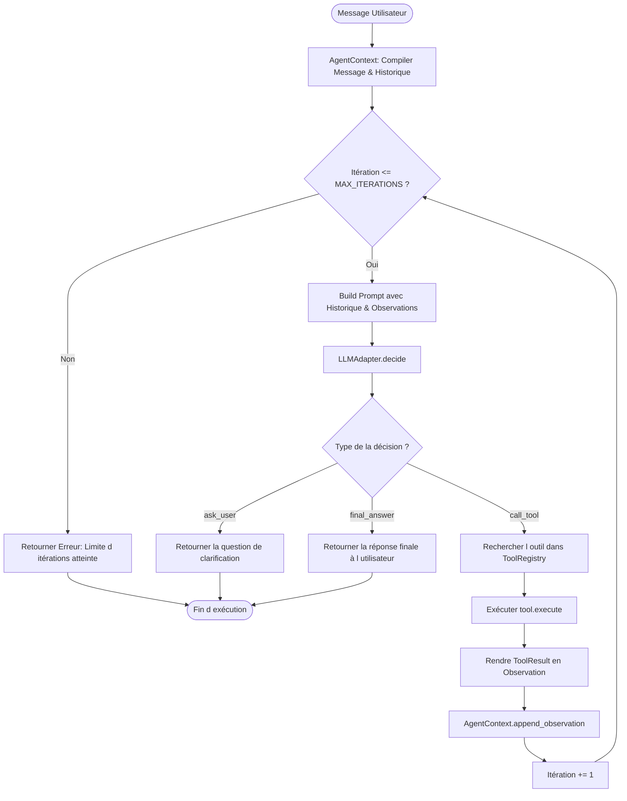

# Axora — FEAT-05 : Spécifications & Documentation Technique de la Boucle d Execution Bornée et du Runtime Agent

**Version :** 0.9
**Statut :** Documentation technique détaillée de FEAT-05
**Composants :** `src/axora/agent/` (`context.py`, `loop.py`, `runtime.py`), `src/axora/cli.py`

---

## 1. Présentation de FEAT-05

FEAT-05 fournit le moteur principal d orchestration d Axora :
1. **`AgentContext` (`src/axora/agent/context.py`)** : Construit dynamiquement le prompt système enrichi de l historique des conversations et des observations d outils.
2. **`run_agent_loop` (`src/axora/agent/loop.py`)** : Exécute la boucle itérative bornée (`Prompt -> Décision LLM -> Exécution Tool -> Observation`).
3. **`AgentRuntime` (`src/axora/agent/runtime.py`)** : Orchestrateur de haut niveau combinant adaptateurs LLM, registre d outils et boucle d exécution.

---

## 2. Diagramme d Architecture et de Flux de la Boucle Agentique



---

## 3. Déroulement d un Cycle d Exécution (Scénario Nominal)

```mermaid
sequenceDiagram
    autonumber
    participant Client as User / CLI / API
    participant Runtime as AgentRuntime
    participant Loop as run_agent_loop
    participant Adapter as LLMAdapter
    participant Registry as ToolRegistry
    participant Tool as DiscoverModelTool / QueryDataTool

    Client->>Runtime: process_intent("Qui sont les membres ?")
    Runtime->>Loop: run_agent_loop(...)

    loop Max Iterations (default = 8)
        Loop->>Adapter: decide(prompt, tools_schema)
        Adapter-->>Loop: AgentDecision(type="call_tool", name="discover_model")
        Loop->>Registry: get("discover_model")
        Registry-->>Loop: Tool Instance
        Loop->>Tool: execute(arguments)
        Tool-->>Loop: ToolResult(status="success", data=...)
        Loop->>Loop: Append Observation to Context
    end

    Loop->>Adapter: decide(prompt, tools_schema)
    Adapter-->>Loop: AgentDecision(type="final_answer", content="Voici la réponse.")
    Loop-->>Runtime: "Voici la réponse."
    Runtime-->>Client: "Voici la réponse."
```

---

## 4. Garanties de Robustesse & Sécurité

1. **Borne Supérieure Stricte :** Le paramètre `max_iterations` (défaut `MAX_AGENT_ITERATIONS` = 8) prévient tout risque de boucle infinie ou de surconsommation de crédits API LLM.
2. **Auto-correction sur Erreur d Outil :** En cas d erreur lors de l exécution d un outil (ex: paramètre manquant), l erreur est capturée et réinjectée sous forme d observation `status="error"`. L agent dispose ainsi d une chance de corriger ses arguments au tour suivant.

---

## 5. Validation par les Tests Unitaires

La suite de tests dans `tests/test_agent_loop.py` couvre :
1. Réponse directe sans appel d outil (`final_answer`).
2. Demande de clarification utilisateur (`ask_user`).
3. Enchaînement itératif d un appel d outil suivi d une réponse finale.
4. Arrêt propre lorsque la limite maximale d itérations est atteinte.
5. Fonctionnement global de `AgentRuntime`.

**Commande d exécution :**
```bash
PYTHONPATH=src python3 -m pytest tests/test_agent_loop.py
```

---

**Axora — From intent to action.**
