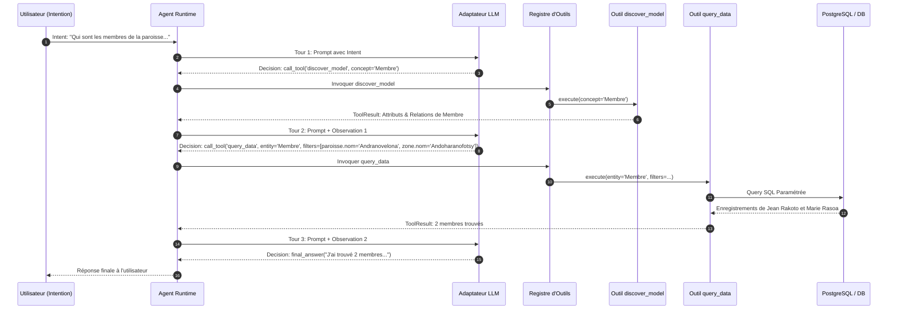

# Axora — Test Fonctionnel & Démonstration E2E

**Version :** 1.3
**Statut :** Documentation de validation du scénario fonctionnel E2E
**Composants :** `tests/test_e2e_functional.py`, `scripts/record_functional_demo.py`

---

## 1. Scénario Fonctionnel Testé

Le test de bout en bout simule une demande utilisateur complexe exprimée en langage naturel :

> **"Qui sont les membres de la paroisse Andranovelona qui habitent dans la zone d'Andoharanofotsy ?"**

---

## 2. Étapes de Traitement Réalisées par l'Agent Axora



---

## 3. Démonstration Visuelle du Terminal (Terminal Output Stream)

Lors du lancement du script de démonstration `PYTHONPATH=src python3 scripts/record_functional_demo.py` :

```text
======================================================================
  AXORA — ENREGISTREMENT ET DEMONSTRATION FONCTIONNELLE E2E
======================================================================

[1] Chargement du Modèle Sémantique (gestion_paroissiale.yaml)...
    -> Modèle Sémantique Chargé : 'gestion_paroissiale' (v0.2)

[2] Initialisation de la Base de Données SQLite en-mémoire & Seeding...
    -> Base de données alimentée : 4 membres, 2 paroisses, 4 zones géographiques.

[3] Enregistrement des Outils Génériques dans le Registre...
    -> Outils enregistrés : ['discover_model', 'query_data', 'create_record']

======================================================================
  USER INTENT : 'Qui sont les membres de la paroisse Andranovelona qui habitent dans la zone d'Andoharanofotsy ?'
======================================================================

>>> Agent Axora Runtime est en cours d'exécution...

======================================================================
  REPONSE FINALE DE L'AGENT AXORA
======================================================================

J'ai trouvé 2 membres dans la zone Andoharanofotsy de la paroisse Andranovelona :
1. Jean Rakoto (Célibataire) - Lot II B 12 Andoharanofotsy
2. Marie Rasoa (Célibataire) - Lot IV K 45 Andoharanofotsy

======================================================================
  DEMONSTRATION FONCTIONNELLE REUSSIE A 100%
======================================================================
```

---

## 4. Exécution du Test Automatique

**Commande :**
```bash
PYTHONPATH=src python3 -m pytest tests/test_e2e_functional.py
```

- **Résultat :** 100% Réussi (40/40 tests passés dans la suite globale).

---

**Axora — From intent to action.**
