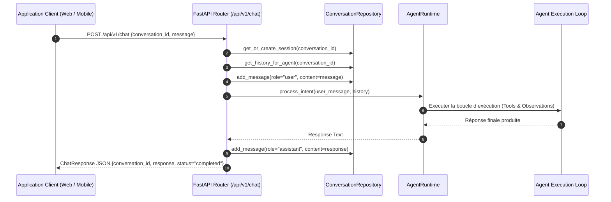

# Axora — FEAT-07 : Spécifications & Documentation Technique de l API Chat FastAPI et Persistance des Conversations

**Version :** 1.5
**Statut :** Documentation technique détaillée de FEAT-07
**Composants :** `src/axora/api/routes.py`, `src/axora/conversations/repository.py`, `src/axora/main.py`

---

## 1. Présentation de FEAT-07

FEAT-07 complète l agent Axora en l exposant via des **endpoints REST HTTP FastAPI** pour les applications clients Web et Mobiles.

Elle comprend :
1. **L endpoint conversationnel `POST /api/v1/chat`** pour traiter les messages en langage naturel via l Agent Runtime.
2. **L endpoint d historique `GET /api/v1/conversations/{id}`** pour consulter les sessions conversationnelles passées.
3. **Le dépôt de persistance `ConversationRepository`** stockant l historique horodaté des messages et gérant les identifiants de session uniques (`UUID`).

---

## 2. Architecture & Routes HTTP FastAPI

```text
src/axora/
├── api/
│   └── routes.py               # Routes POST /chat et GET /conversations/{id}
├── conversations/
│   └── repository.py           # Modèles Pydantic ConversationSession, Message et Repository
└── main.py                     # Point d entrée de l application FastAPI
```

---

## 3. Contrats API REST HTTP

### 3.1 Endpoint Traitement d Intention (`POST /api/v1/chat`)

- **URL :** `http://localhost:8000/api/v1/chat`
- **Méthode :** `POST`
- **Exemple de Request Body :**
  ```json
  {
    "conversation_id": "3fa85f64-5717-4562-b3fc-2c963f66afa6",
    "message": "Qui sont les membres de la paroisse Andranovelona qui habitent dans la zone d'Andoharanofotsy ?"
  }
  ```
- **Exemple de Response Body (Status 200 OK) :**
  ```json
  {
    "conversation_id": "3fa85f64-5717-4562-b3fc-2c963f66afa6",
    "response": "J'ai trouvé 2 membres correspondant à votre demande...",
    "status": "completed"
  }
  ```

### 3.2 Endpoint Historique Session (`GET /api/v1/conversations/{conversation_id}`)

- **URL :** `http://localhost:8000/api/v1/conversations/3fa85f64-5717-4562-b3fc-2c963f66afa6`
- **Méthode :** `GET`
- **Exemple de Response Body (Status 200 OK) :**
  ```json
  {
    "id": "3fa85f64-5717-4562-b3fc-2c963f66afa6",
    "messages": [
      {
        "id": "c1f7a012-...",
        "role": "user",
        "content": "Qui sont les membres de la paroisse ?",
        "timestamp": "2024-03-30T10:15:30.123456+00:00"
      },
      {
        "id": "d2f8b023-...",
        "role": "assistant",
        "content": "J'ai trouvé 4 membres...",
        "timestamp": "2024-03-30T10:15:32.654321+00:00"
      }
    ],
    "created_at": "2024-03-30T10:15:30.123456+00:00",
    "updated_at": "2024-03-30T10:15:32.654321+00:00"
  }
  ```

---

## 4. Diagramme de Séquence de Traitement d une Requête HTTP



---

## 5. Validation par les Tests Unitaires & d Intégration

La suite de tests dans `tests/test_chat_api.py` vérifie :
1. Le point de terminaison de contrôle de santé `/health`.
2. L envoi d un premier message sur l endpoint `POST /api/v1/chat` et la génération d un `conversation_id`.
3. La persistance et la relecture de l historique des messages via `GET /api/v1/conversations/{id}`.

**Commande d exécution :**
```bash
PYTHONPATH=src python3 -m pytest tests/test_chat_api.py
```

---

**Axora — From intent to action.**
