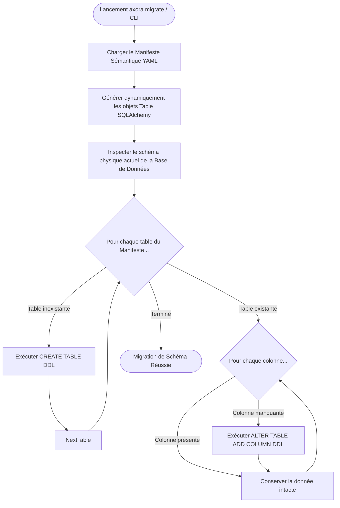

# Axora — CLI et Moteur de Migration Automatique de Base de Données

**Version :** 1.6
**Statut :** Documentation technique de la migration dynamique de schéma
**Composants :** `src/axora/data/migrations.py`, `src/axora/migrate.py`, `tests/test_migrations.py`

---

## 1. Présentation du Moteur de Migration

Le moteur de migration `DynamicSchemaMigrator` compare en temps réel le schéma physique de la base de données PostgreSQL/SQLite avec les entités et attributs déclarés dans le **manifeste du modèle sémantique** (`gestion_paroissiale.yaml`).

Il élimine toute intervention ou écriture manuelle de scripts DDL / migrations SQL lors de l ajout, la modification ou la suppression d entités et de colonnes.

---

## 2. Déroulement Automatique des MIGRATIONS DDL



---

## 3. Lancement des Migrations

### En local (Sans Docker) :
```bash
PYTHONPATH=src python3 -m axora.migrate
```

### Via Docker Compose :
```bash
docker compose exec api python -m axora.migrate
```

---

## 4. Validation par les Tests Automatiques

La suite de tests unitaires et d intégration dans `tests/test_migrations.py` vérifie :
1. La création automatique de toutes les tables sur une base fraîche.
2. L ajout dynamique d une colonne manquante via `ALTER TABLE ADD COLUMN` sans perte de données.

**Commande d exécution :**
```bash
PYTHONPATH=src python3 -m pytest tests/test_migrations.py
```

---

**Axora — From intent to action.**
