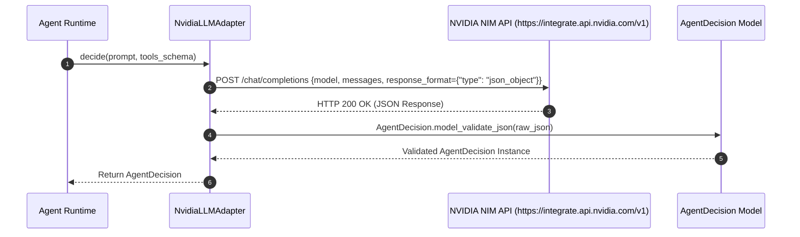

# Axora — Adaptateur LLM NVIDIA NIM & Configuration des Tokens API Gratuits

**Version :** 1.7
**Statut :** Documentation technique et guide d obtention de clés API NVIDIA gratuites
**Composants :** `src/axora/llm/provider.py` (`NvidiaLLMAdapter`), `src/axora/config.py`

---

## 1. Pourquoi l Adaptateur NVIDIA NIM ?

NVIDIA propose via sa plateforme **NVIDIA NIM / build.nvidia.com** un accès gratuit avec des crédits offerts à des modèles de langage de pointe de classe mondiale tels que :
- `meta/llama-3.1-70b-instruct`
- `meta/llama-3.1-405b-instruct`
- `mistralai/mistral-large-2-instruct`

Ces modèles sont hébergés sur l infrastructure accélérée NVIDIA avec des endpoints 100% compatibles avec la norme OpenAI Chat Completions API REST (`https://integrate.api.nvidia.com/v1`).

---

## 2. Procédure d Obtention d une Clé API NVIDIA Gratuite

1. Rendez-vous sur la plateforme officielle NVIDIA NIM : [build.nvidia.com](https://build.nvidia.com)
2. Connectez-vous avec votre compte NVIDIA (ou créez-en un gratuitement).
3. Sélectionnez le modèle souhaité (ex: **Llama 3.1 70B Instruct**).
4. Cliquez sur le bouton **"Get API Key"** pour générer votre clé commençant par `nvapi-...`.
5. Vous disposez immédiatement de jetons (tokens) gratuits pour tester votre agent Axora en conditions réelles.

---

## 3. Configuration dans Axora (`.env`)

Pour utiliser NVIDIA NIM avec l agent Axora, ajoutez ou modifiez les variables suivantes dans votre fichier `.env` :

```env
# Sélection du Fournisseur LLM NVIDIA
LLM_PROVIDER=nvidia

# Clé API NVIDIA NIM officielle (obtenue sur build.nvidia.com)
NVIDIA_API_KEY=nvapi-votre-cle-api-nvidia-gratuite-ici

# Endpoint REST NVIDIA NIM
NVIDIA_BASE_URL=https://integrate.api.nvidia.com/v1

# Modèle NVIDIA NIM au choix
NVIDIA_MODEL=meta/llama-3.1-70b-instruct
```

---

## 4. Architecture de l Adaptateur `NvidiaLLMAdapter`



---

## 5. Validation par les Tests Unitaires

La suite de tests dans `tests/test_llm_adapter.py` vérifie :
1. Le bon fonctionnement de la fabrique `get_llm_adapter("nvidia")`.
2. Le repli automatique (fallback) sur le mode mock sécurisé lorsque la clé API NVIDIA est absente ou non configurée lors des tests d intégration hors-ligne.

**Commande d exécution :**
```bash
PYTHONPATH=src python3 -m pytest tests/test_llm_adapter.py
```

---

**Axora — From intent to action.**
