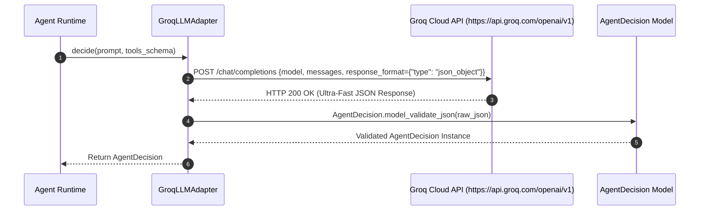

# Axora — Adaptateur LLM Groq Cloud & Configuration des Tokens API Gratuits

**Version :** 1.8
**Statut :** Documentation technique et guide d obtention de clés API Groq gratuites
**Composants :** `src/axora/llm/provider.py` (`GroqLLMAdapter`), `src/axora/config.py`

---

## 1. Pourquoi l Adaptateur Groq Cloud LPU ?

Groq propose une infrastructure d accélération matérielle (Language Processing Units - LPU) offrant des temps de réponse d inférence ultrarapides (> 500 tokens/sec) et un accès **100% gratuit** à des modèles open-source majeurs :
- `llama-3.3-70b-versatile`
- `llama-3.1-8b-instant`
- `mixtral-8x7b-32768`

Leur API Cloud (`https://api.groq.com/openai/v1`) respecte scrupuleusement la norme OpenAPI Chat Completions.

---

## 2. Procédure d Obtention d une Clé API Groq Gratuite

1. Rendez-vous sur la console officielle Groq Cloud : [console.groq.com](https://console.groq.com)
2. Créez un compte ou connectez-vous via GitHub/Google.
3. Accédez à la rubrique **"API Keys"** dans le menu latéral.
4. Cliquez sur **"Create API Key"** et copiez votre clé commençant par `gsk_...`.

---

## 3. Configuration dans Axora (`.env`)

Pour utiliser Groq Cloud avec l agent Axora, configurez les variables suivantes dans votre fichier `.env` :

```env
# Sélection du Fournisseur LLM Groq
LLM_PROVIDER=groq

# Clé API Groq Cloud officielle (obtenue sur console.groq.com)
GROQ_API_KEY=gsk_votre_cle_api_groq_gratuite_ici

# Endpoint REST Groq Cloud
GROQ_BASE_URL=https://api.groq.com/openai/v1

# Modèle Groq au choix
GROQ_MODEL=llama-3.3-70b-versatile
```

---

## 4. Architecture de l Adaptateur `GroqLLMAdapter`



---

## 5. Validation par les Tests Unitaires

La suite de tests dans `tests/test_llm_adapter.py` vérifie :
1. La création via la fabrique `get_llm_adapter("groq")`.
2. Le repli automatique (fallback) sur le mode mock dynamique lorsque la clé API Groq est absente ou non configurée lors des tests hors-ligne.

**Commande d exécution :**
```bash
PYTHONPATH=src python3 -m pytest tests/test_llm_adapter.py
```

---

**Axora — From intent to action.**
