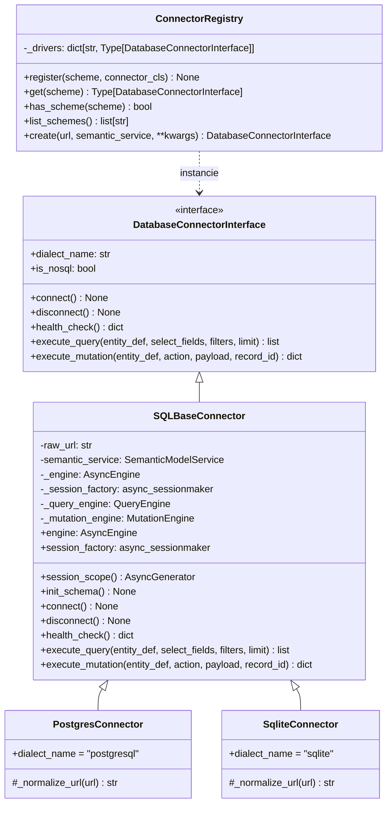
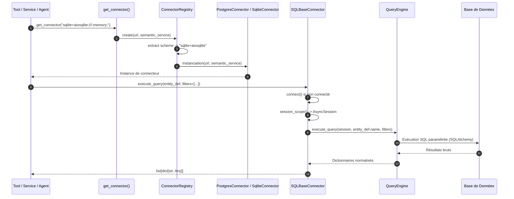

# AXORA — Conception & Implémentation du Jalon 1 : Socle des Connecteurs Pluggables (PostgreSQL & SQLite)

> **Document de Spécification Technique & Guide d'Implémentation (v3.1)**  
> *Mise en œuvre du Jalon 1 de l'architecture pluggable : abstraction universelle, registre de drivers et connecteurs PostgreSQL & SQLite.*

---

## 🎯 1. Contexte & Objectifs du Jalon 1

Dans le cadre de la feuille de route **Axora v3.0** ([axora_3.0-Architecture_Connecteurs_BDD_Pluggables_Extensions.md](file:///home/fetraharinjatovo/Architecture%20Plateform/axora/axora_3.0-Architecture_Connecteurs_BDD_Pluggables_Extensions.md)), Axora s'émancipe de son lien direct avec PostgreSQL pour devenir une plateforme de données universelle, capable de se brancher indifféremment sur n'importe quel moteur relationnel ou documentaire (MySQL, MongoDB, Oracle, SQL Server).

Le **Jalon 1** pose les fondations indispensables sans régression fonctionnelle :
1. **Création du module d'extensions BDD** sous `src/axora/extensions/bdd/`.
2. **Définition de l'interface abstraite universelle** `DatabaseConnectorInterface`.
3. **Mise en place du registre dynamique** `ConnectorRegistry` basé sur le schéma d'URI (`scheme://`).
4. **Implémentation du socle commun SQL** `SQLBaseConnector` unifiant le cycle de vie du pool SQLAlchemy Async, l'exécution des requêtes (`QueryEngine`) et les mutations (`MutationEngine`).
5. **Développement des drivers initiaux** :
   - `PostgresConnector` : pilote de production PostgreSQL (`psycopg3`).
   - `SqliteConnector` : pilote pour tests ultra-rapides et mode local/embarqué (`aiosqlite`).
6. **Rétro-compatibilité intégrale** avec le code existant (`src/axora/data/database.py`, `QueryDataTool`, etc.).

---

## 📐 2. Conception Architecturelle & Diagrammes

### 2.1 Diagramme de Classes (Design Patterns Factory & Strategy)



### 2.2 Diagramme de Séquence : Cycle d'Exécution d'une Requête Sémantique



---

## 📁 3. Arborescence du Code Réalisée

Le code du Jalon 1 est organisé sous `src/axora/extensions/bdd/` :

```text
src/axora/extensions/bdd/
├── __init__.py           # Enregistrement des drivers par défaut et fonction `get_connector()`
├── interface.py          # Contrat universel `DatabaseConnectorInterface`
├── registry.py           # Registre dynamique `ConnectorRegistry`
└── sql/
    ├── __init__.py       # Export des connecteurs de la famille SQL
    ├── base.py           # `SQLBaseConnector` (cycle de vie, pool, query, mutation)
    ├── postgres.py       # `PostgresConnector` (driver psycopg3)
    └── sqlite.py         # `SqliteConnector` (driver aiosqlite & StaticPool mémoire)
```

---

## ⚙️ 4. Détail des Composants Implémentés

### 4.1 L'Interface Universelle (`src/axora/extensions/bdd/interface.py`)
Définit le cycle de vie obligatoire pour toute source de données dans Axora :
- `dialect_name` : Nom du dialecte normalisé (`postgresql`, `sqlite`, etc.).
- `is_nosql` : Booléen signalant les bases documentaires (MongoDB).
- `connect()` et `disconnect()` : Gestion asynchrone des ressources et du pooling.
- `health_check()` : Sonde de disponibilité et mesure de la latence (ping).
- `execute_query(...)` : Lecture sémantique sans SQL brut avec filtrage AST.
- `execute_mutation(...)` : Création et modification avec validation des contraintes sémantiques.

### 4.2 Le Registre Pluggable (`src/axora/extensions/bdd/registry.py`)
Gère l'enregistrement dynamique des drivers :
- Résolution insensible à la casse du schéma d'URL (ex. `postgresql`, `postgresql+psycopg`, `sqlite`, `sqlite+aiosqlite`).
- Détection d'erreurs claire si un schéma n'est pas supporté.
- Méthode `create(url, semantic_service, **kwargs)` pour instancier à chaud le bon connecteur.

### 4.3 Le Socle Commun SQL (`src/axora/extensions/bdd/sql/base.py`)
Évite la duplication de code entre connecteurs relationnels :
- Initialise `create_async_engine` et `async_sessionmaker`.
- Intègre `QueryEngine` et `MutationEngine` en leur injectant les sessions asynchrones.
- Propose un gestionnaire de contexte transactionnel `session_scope()`.
- Fournit la méthode utilitaire `init_schema()` pour provisionner dynamiquement les tables à partir du manifeste sémantique.
- Masque les mots de passe dans les logs (`_safe_log_url`).

### 4.4 Les Pilotes Concrets :
- **PostgresConnector** (`src/axora/extensions/bdd/sql/postgres.py`) :
  - Normalise automatiquement `postgresql://` vers `postgresql+psycopg://`.
  - Active par défaut `pool_pre_ping=True` pour éliminer les connexions orphelines.
- **SqliteConnector** (`src/axora/extensions/bdd/sql/sqlite.py`) :
  - Normalise `sqlite://` vers `sqlite+aiosqlite://`.
  - Configure `StaticPool` et `check_same_thread=False` pour le mode mémoire (`:memory:`), garantissant que les tables persistent entre transactions successives.

---

## 🧪 5. Stratégie de Test et Validation Non-Régression

Une suite de tests complète a été ajoutée dans [tests/test_bdd_connectors.py](file:///home/fetraharinjatovo/Architecture%20Plateform/axora/tests/test_bdd_connectors.py) :

| Test Case | Description | Objectif de Validation |
|---|---|---|
| `test_connector_registry_defaults` | Vérification de l'enregistrement des drivers de base | Valide la disponibilité de `postgresql` et `sqlite`. |
| `test_connector_registry_custom_registration` | Ajout d'un driver mock personnalisé | Prouve l'extensibilité du registre. |
| `test_url_normalization` | Vérification de la réécriture des URLs | Valide les préfixes asynchrones SQLAlchemy. |
| `test_sqlite_connector_lifecycle` | Cycle `connect` $\rightarrow$ `health_check` $\rightarrow$ `disconnect` | Valide le ping et la mesure de latence. |
| `test_sqlite_connector_semantic_operations` | Insertion, lecture filtrée et mise à jour sémantique | Valide l'orchestration avec `QueryEngine` et `MutationEngine`. |
| `test_sqlite_connector_validation_error` | Tentative d'insertion avec valeur interdite (`DIVORCE`) | Vérifie la levée obligatoire de `BusinessRuleViolation`. |
| `test_get_connector_factory` | Appel de la factory `get_connector(url)` | Valide la résolution automatique du bon type de connecteur. |

---

## 📖 6. Guide d'Utilisation

### Exemple 1 : Obtenir un connecteur via la configuration `.env`
```python
from axora.extensions.bdd import get_connector
from axora.semantic.service import SemanticModelService

semantic_service = SemanticModelService.from_yaml("src/axora/semantic/definitions/gestion_paroissiale.yaml")

# Connecteur automatique basé sur DATABASE_URL
connector = get_connector(semantic_service=semantic_service)

# Vérifier l'état de la base
health = await connector.health_check()
print(f"Base opérationnelle : {health['dialect']}, latence : {health['latency_ms']}ms")
```

### Exemple 2 : Exécuter une requête sémantique abstraite
```python
paroisse_def = semantic_service.get_entity_details("Paroisse")

records = await connector.execute_query(
    entity_def=paroisse_def,
    filters=[{"path": "nom", "operator": "equals", "value": "Andranovelona"}],
    limit=10,
)
for record in records:
    print(record["nom"])
```

### Exemple 3 : Enregistrer un nouveau driver tiers
```python
from axora.extensions.bdd import connector_registry
from my_custom_package import CockroachDBConnector

connector_registry.register("cockroachdb", CockroachDBConnector)
```

---

## 🏁 Bilan du Jalon 1

- [x] Dossier `src/axora/extensions/bdd/` et architecture modulaire en place.
- [x] Contrats formels `DatabaseConnectorInterface` et `ConnectorRegistry`.
- [x] Implémentation de `SQLBaseConnector`, `PostgresConnector` et `SqliteConnector`.
- [x] Rétro-compatibilité assurée dans [src/axora/data/database.py](file:///home/fetraharinjatovo/Architecture%20Plateform/axora/src/axora/data/database.py).
- [x] Tests unitaires et d'intégration validés dans [tests/test_bdd_connectors.py](file:///home/fetraharinjatovo/Architecture%20Plateform/axora/tests/test_bdd_connectors.py).
- [x] Prochaine étape : **Jalon 2** (Connecteur MySQL / MariaDB).
